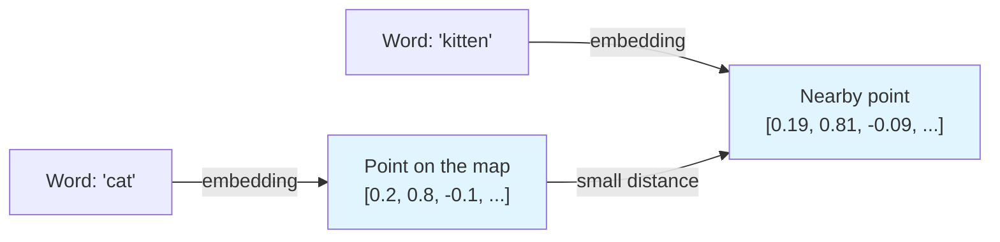
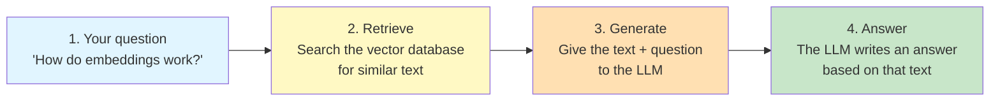

# Lessons Project — Governing Principles & Development Guidelines

**Scope:** This document governs every lesson produced under this project. A "lesson" is a self-contained learning unit made of a code file (a Jupyter notebook `.ipynb` or a Python script `.py`), a companion markdown file (`.md`), and a required assignment file (`-assignment.md`), plus any supporting files the lesson genuinely needs. These principles apply to every lesson, every author, every time — they are the definition of "done" and "consistent" for this catalog.

**How to read this document:**
- It is organized into **Articles I–VI**. "Article N" always means a part of this document; **"Section N" always means one of the 11 sections of a lesson's `.md` file** (Article I).
- **Every rule here is a hard constraint:** the Article I structure, every numbered rule (CQ-, UX-, PF-), and every Pre-Publish Checklist item. The only exceptions are values explicitly marked as a *reference* or *suggestion* (the CQ-1 line reference, the Section 7 page suggestion). Follow those by default; exceed them only where the scope genuinely requires it, and flag it.
- `GUIDELINES.md` is the practical companion (how to apply these rules, with examples). If the two ever disagree, this document wins.

**Amendments:** If a principle stops making sense for a real lesson, that's a signal to revise this document, not to quietly break the rule. Follow the Governance process at the end, add a line to the version history below, and update the version footer.

**Version history:**
- `v1.0.0` — initial governing document
- `v2.0.0` — removed the Lesson Tracker requirement (Excel/CSV gate log) and its checklist item
- `v2.1.0` — Mermaid diagrams are now a default requirement for any flow/pipeline/architecture concept in Section 7, not optional
- `v2.2.0` — every notebook must begin with a single `!pip install` cell (CQ-10) installing all required modules so learners can install dependencies directly
- `v3.0.0` — every lesson now ships a required assignment file (`lesson-<slug>-assignment.md`) with knowledge-check exercises and an answer key (UX-7)
- `v4.0.0` — Testing Standards removed from this document; the five-gate validation workflow now lives in `AGENTS.md`, with `TEST.md` as the companion test-format rule
- `v5.0.0` — CQ-1 line limits are now a reference/scoping guideline, not a strict compliance cap; authors may exceed where scope genuinely requires it
- `v6.0.0` — lesson structure reduced to 11 sections: Lesson Title replaced by Explanation of Topic, Optional Exercise removed, Prerequisites and Environment Setup made optional; Gate 4 now tests the assignment file
- `v6.1.0` — Section 1 (Explanation of Topic) must use simple fundamental language, bullet points, at least one everyday example, and a simple diagram
- `v6.2.0` — every complex code step gets a dedicated explainer, plus a diagram when the step involves a flow, branching, or data changing shape (CQ-11)
- `v6.3.0` — diagrams capped at 7 blocks (split into parts if larger); every logical code block starts with a plain-language comment (CQ-2)
- `v6.4.0` — UX-2 expanded: active voice, "we"/"you", simple words, and a warm, human tone throughout the lesson
- `v7.0.0` — "lab" renamed to "lesson" throughout, including file names (`lesson-<topic-slug>.*`)
- `v8.0.0` — difficulty levels (Beginner/Intermediate/Advanced) removed; their code quality and explanation rules merged into one Code Quality Standards section; CQ-1 uses a single ~150-line reference; UX-6 header drops the difficulty label
- `v8.1.0` — every acronym is spelled out in full the first time it appears in a lesson (UX-2)
- `v9.0.0` — chapters renamed to Articles I–VI; lesson `.md` skeleton added; the notebook holds only code and the markdown that explains it (everything else lives in the `.md`); explanations come after the code they explain; CQ-1 counts raw code lines only; Section 8 required in defined cases; series exception to the no-cross-reference rule; UX-8 (self-contained lessons) and the real-world example rule added; Section 1 diagram is always required

---

## Article I — The Canonical Lesson Structure

### Lesson files

Every lesson consists of three files with the same slug, in the same folder (UX-4), plus any supporting files genuinely needed (data files, config, etc.):

| File | What it holds |
|------|---------------|
| `lesson-<topic-slug>.md` | The full lesson narrative: the title, the header line, and all 11 sections below. |
| `lesson-<topic-slug>.ipynb` **or** `lesson-<topic-slug>.py` | The runnable code — and only the code plus the explanations of that code (see "What goes in the code file"). |
| `lesson-<topic-slug>-assignment.md` | Knowledge-check exercises with an answer key (UX-7). |

Use `.ipynb` for exploratory, visual, or step-by-step learning; use `.py` for clean, production-like code lessons. Both follow the same rules.

### What goes in the code file

The code file contains **only code and the markdown that explains that code**. Everything else — the title, header line, and Sections 1–9 and 11 — lives only in the `.md` file.

- **`.ipynb`:**
  - The first cell is the `!pip install` code cell (CQ-10), followed by one markdown cell explaining it.
  - After that, the notebook alternates: a code cell, then a markdown cell that explains it (CQ-2). For a complex step, that markdown cell holds the full explainer and any diagram (CQ-11).
  - No other markdown cells: no title cell, no introduction, no theory, no recap.
- **`.py`:** the same pattern, with each explanation written as a comment block placed right after the code block it explains. There is no `!pip install` line; setup lives in Section 9 (`requirements.txt`).

**Section 10 of the `.md` mirrors the code file:** the same code blocks, in the same order, each followed by the same explanation. Keep the two in sync — when you change one, change the other.

### The 11 sections of the `.md` file

Every lesson's `.md` file follows this section order, exactly. A learner who's done three lessons should be able to navigate a fourth without re-learning where things live.

| # | Section | What goes here | Length guidance |
|---|---------|----------------|------------------|
| 1 | **Explanation of Topic** | A simple, fundamental introduction to the topic — what it is and why it matters — written so a newcomer understands it on first read: plain words, bullet points, at least one everyday example, and a simple diagram | 1–2 framing sentences, then bullets, an example, and one diagram |
| 2 | **Problem Statement / Use Case Overview** | What real problem this lesson solves, in plain terms | 3–6 sentences |
| 3 | **Input** | What data goes in, format, source (sample/synthetic/real), size | Short paragraph or bullets |
| 4 | **Processing** | What happens to the data — the pipeline/steps at a conceptual level | Short paragraph or bullets |
| 5 | **Output** | What the learner should see when it works — describe it concretely | Short paragraph, screenshot/sample output encouraged |
| 6 | **Tech Stack** | Every library, model, API, and service used, with version | Bullet list |
| 7 | **Underlying Concepts** | The theory needed to understand *why*, not just *how* | **Suggested pages: 2** (may exceed if the content genuinely requires it) |
| 8 | **Prerequisites** *(Optional — see below)* | Background knowledge, accounts/API keys, hardware, and (for a series part) the earlier parts | Bullet list |
| 9 | **Environment / Dependencies Setup** *(Optional — see below)* | Exact steps to get a clean environment running | Copy-pasteable commands |
| 10 | **Step-wise Development Instructions** | The actual build: the code blocks from the code file, each followed by its explanation (see Article II) | Bulk of the lesson |
| 11 | **What We Learnt** | Recap of concepts and skills, tying back to Section 7 | 4–8 bullets |

**Required and optional sections:**
- Sections 1–7, 10, and 11 are required in every lesson.
- **Section 8 (Prerequisites)** is optional, but **required** when the lesson needs any of: an account, API key, or paid service; hardware beyond a laptop CPU; or an earlier part of the same series (UX-8).
- **Section 9 (Environment / Dependencies Setup)** is optional for `.ipynb` lessons, whose first `!pip install` cell carries the setup (CQ-10). It is **required** for `.py` lessons.
- When an optional section is left out, omit its heading entirely. **Keep the numbers fixed** — if Section 8 is omitted, the headings go from 7 to 9 — so "Section 10" always means Step-wise Development Instructions.

### `.md` file skeleton

Copy this skeleton exactly. The headings — including their numbers and wording — must match in every lesson.

```markdown
# <Lesson Title>

~<N> min · Needs: <key prerequisites, or "nothing beyond basic Python">

## 1. Explanation of Topic

## 2. Problem Statement / Use Case Overview

## 3. Input

## 4. Processing

## 5. Output

## 6. Tech Stack

## 7. Underlying Concepts

## 8. Prerequisites

## 9. Environment / Dependencies Setup

## 10. Step-wise Development Instructions

## 11. What We Learnt
```

- **Title:** the top-level `#` heading — short, descriptive, and matching the file's slug.
- **Header line:** directly under the title (UX-6).
- Delete the Section 8 and 9 headings only when the rules above allow it.

### Writing Section 1

**Section 1 is written for easy understanding.** Start from fundamentals and assume no prior knowledge of the topic:
- **Simple language** — short sentences, everyday words; define any unavoidable term in one line.
- **Bullet points** — break the explanation into short points (one idea each) instead of dense paragraphs.
- **At least one example** — a short, real-world, universal example that makes the idea tangible (UX-2; e.g., "an embedding is like GPS coordinates for meaning").
- **A simple diagram — always.** One small Mermaid diagram (see Article V) showing the core idea at a glance, with 7 blocks or fewer. This applies to every topic, even simple ones. Detailed pipeline/architecture diagrams belong in Section 7.

---

## Article II — Code Quality Principles

### Universal Code Quality Rules

**CQ-1. Line limit (reference, not a hard cap).**
This is a teaching constraint, not a style preference — beyond the reference ceiling, a learner tends to lose the plot. Reference line limit: **about 150 lines of code** per lesson.
- **What counts:** only raw code lines. Do not count comments, docstrings, blank lines, markdown cells, or the `!pip install` line.
- **Reference, not a cap:** if the real build genuinely needs more lines, it may exceed the reference — flag it. Do not stretch or truncate a lesson just to hit the number.
- **Splitting:** prefer a numbered lesson series (`Lesson 2a`, `Lesson 2b`...) when the content naturally divides (see UX-8 for how series parts may refer to each other).

**CQ-2. Every code block is explained, not just labeled.**
- **After the code:** every code block is followed by an explanation of *what it does and why it's there* — a markdown cell right after the code cell in a notebook, a comment block right after the block in a `.py` file, and the same text right after the block in Section 10 of the `.md`. Explanations always come after the code, never before.
- **Inside the code:** every logical block (a group of lines doing one job) starts with a comment explaining it in easy, everyday words.
- The Code Quality Standards below set the depth. Assume the learner may not know the library, not just the concept.

**CQ-3. One logical step per cell.**
Load data, chunk it, embed it, store it, query it — each gets its own cell. This lets a learner run and inspect incrementally instead of debugging a wall of code.

**CQ-4. No unexplained magic.**
If a helper function or library call hides real complexity (a `.fit()`, a chained API call, a config object with many fields), the explanation says what it's abstracting. A learner should never have to go read external docs just to understand what a line in *this* lesson does.

**CQ-5. Consistent, idiomatic style.**
Standard formatting for the language (PEP8 for Python, etc.), descriptive variable names (`chunked_docs`, not `x2`), and no dead code left in from earlier drafts.

**CQ-6. Reproducible by construction.**
Dependency versions are pinned — in Section 6, in the notebook's first `!pip install` cell (CQ-10), and in Section 9 when the lesson includes it. No reliance on hidden local state, undocumented files, or "works on my machine" steps.

**CQ-7. Secrets are never hardcoded.**
API keys and credentials are read from environment variables or a `.env` file, with a placeholder and a one-line instruction for how the learner supplies their own (listed in Section 8, which is then required).

**CQ-8. Restart-and-run-all always works.**
A notebook must run top to bottom in a fresh kernel with no manual steps skipped or reordered. This is the single most common way lessons silently rot — enforce it every time, not just at first publish.

**CQ-9. Minimize helper functions — use inline code instead.**
Every helper function you define requires learners to understand what it does, often by reading code that's separated from where it's used. Where possible, write code inline even if it's slightly longer. Only use a helper function if (a) it's called multiple times in the lesson, or (b) it abstracts a concept that's important to teach separately. Inline code is harder to write but easier for learners to follow and modify.

**CQ-10. Every notebook starts with a `!pip install` cell.**
The first code cell installs every module the lesson needs in a single line — `!pip install <module1> <module2> ...` — with pinned versions, so a learner can run the first cell and install everything directly. It matches Section 6 (and Section 9 when present), and it makes the notebook runnable from a fresh kernel without reading the `.md` first. `.py` lessons have no such line; their setup lives in Section 9.

**CQ-11. Every complex step gets an explainer and a diagram where required.**
A step is complex when a learner can't follow it from a one-line description: several operations chained together, a non-obvious algorithm or formula, a loop or branch with more than one path, data changing shape (e.g., text → chunks → vectors), or several components talking to each other. Every such step gets a dedicated explainer **right after the code**, written as bullet points:
- **Input** — what goes into the step (with its shape or type).
- **What happens** — the operations in order, in plain words.
- **Output** — what comes out (with its shape or type).
- **Why** — why this step is needed at this point in the build.

If the step involves a flow, branching, data changing shape, or components interacting, add a small Mermaid diagram (Article V) inside the same explainer. Keep it focused on that one step — the whole-pipeline diagram belongs in Section 7. If the step uses a hard concept, include a short real-world example (UX-2). Simple steps (a single import, reading a file, printing a value) need only CQ-2's short explanation.

---

### Code Quality Standards

The rules above set the minimum. These standards describe *how* every lesson explains and builds its code. They apply to every lesson in the same way, so a learner gets the same depth of explanation everywhere in the catalog.

**Who we write for:** a learner who may be new to the topic and its libraries, but who wants to understand the *why* and to be able to adapt the code to their own project.

**Explanation style:**
- Every code block is followed by a prose explanation of what it did and why we took this approach — the approach, not the syntax.
- Every logical block starts with a plain-language comment (CQ-2). On top of that, add inline comments on non-obvious lines, subtle patterns, and complex logic — but not on every line.
- Spend more words on *why* a line exists than on what it does — context-setting matters.
- Explain library calls at two levels: what the call does (what does `.fit()` do?) and what it does for the pipeline. The lesson says it; it never defers to library docs.
- Don't assume domain knowledge. Define a term the first time it appears (UX-2), then show how this lesson uses it.
- When a design decision has a tradeoff, make it visible: why this approach, what it costs, and what you'd change at scale.
- Rationale for performance choices and important edge cases is part of the explanation wherever it affects the build.
- Variable names are descriptive and unambiguous (`user_query_embedding`, `query_vector` — not `q_emb`, `qv`, or `e`). Standard domain names (`doc_id`, `top_k`) are fine, explained on first use.

**Code construction:**
- Prefer clear library abstractions (e.g., `.fit_transform()`) over custom loops when both are viable. Show custom logic where it helps the learner see the concept, and point out where a component can be swapped for another.
- Error handling is present and instructive: at minimum a `try`/`except` around file I/O and API calls, with messages that tell the learner what to do next (e.g., "if no results, try broadening the search"). Make important edge cases and failure modes visible.
- Language idioms and patterns (list comprehensions, context managers, async/await, decorators) are used only when they serve the concept, and are explained when used. No "gotcha" code that needs prior language knowledge to decode.
- Performance considerations (batching, caching, indexing) are discussed where they matter to the build, without overshadowing the concept being taught.

**About the examples below:** they are excerpts from the middle of a lesson. Acronyms in them (API, CSV, BM25) are assumed to have been spelled out at their first use earlier in that lesson (UX-2), and variables such as `documents` or `client` come from earlier cells.

**Example — a simple step (code cell, then its explanation):**
```python
# Load our sample data: 50 short product reviews, one per row of the CSV file.
try:
    reviews = pd.read_csv("data/reviews.csv")["text"].tolist()
except FileNotFoundError:
    raise SystemExit("Can't find data/reviews.csv — run this notebook from the lesson folder.")
print(f"Loaded {len(reviews)} reviews")
```

```markdown
We read the reviews file into a plain Python list, one review per item. If the
file isn't where we expect, you get a clear message instead of a long error —
the most common cause is starting Jupyter from a different folder.
```

**Example — a pipeline step:**
```python
# Split each document into overlapping pieces so we don't cut an idea in half at a boundary.
splitter = RecursiveCharacterTextSplitter(chunk_size=1000, chunk_overlap=100)
chunks = []
for doc in documents:
    chunks.extend(splitter.split_text(doc))

# Turn every chunk into a vector (a list of numbers), sending 50 chunks per API request.
chunk_vectors = []
for start in range(0, len(chunks), 50):
    batch = chunks[start:start + 50]
    response = client.embeddings.create(model="text-embedding-3-small", input=batch)
    chunk_vectors.extend(item.embedding for item in response.data)

# Save each chunk with its vector in Weaviate, so we can search by meaning later.
for chunk, vector in zip(chunks, chunk_vectors):
    chunk_collection.data.insert(properties={"content": chunk}, vector=vector)
```

**Example — a design tradeoff:**
```python
# Find the best chunks in two stages.
# Stage 1: BM25 quickly finds chunks that share keywords with the question.
# Stage 2: a cross-encoder reads each candidate with the question and reorders them by meaning.
# This trades speed for accuracy — a good fit when answers don't need to be instant, like reports.
def retrieve_and_rerank(question, top_k_keyword=50, top_k_final=10):
    """Return the top_k_final chunks for the question, best first."""
    # Stage 1: keyword search — fast, but blind to meaning.
    candidates = bm25.get_top_n(question.lower().split(), chunks, n=top_k_keyword)

    # Stage 2: score each (question, chunk) pair — slower, but much better at meaning.
    scores = cross_encoder.predict([(question, chunk) for chunk in candidates])

    # Sort by the cross-encoder's score and keep the best few.
    ranked = sorted(zip(candidates, scores), key=lambda pair: pair[1], reverse=True)
    return [chunk for chunk, score in ranked[:top_k_final]]
```

This one uses a helper function because the two-stage search is the concept being taught, and later cells call it several times (CQ-9).

---

## Article III — User Experience Consistency

**UX-1. Structural consistency is non-negotiable.**
Every lesson uses the exact `.md` skeleton and 11-section order from Article I, with the same headings (optional Sections 8 and 9 omitted only where Article I allows). Consistency here is what lets a learner navigate lesson 12 as confidently as lesson 1.

**UX-2. Consistent voice: active, personal, simple, and human.**
All learner-facing text (the `.md` file, the explanations in the code file, code comments, and the assignment) reads like a friendly teacher talking to the learner:
- **Active voice.** Say who does what: "We split the text into chunks", not "The text is split into chunks".
- **Talk to the learner.** Use "you" for the learner and "we" for steps you take together ("Now we load the data", "You'll see a table like this"). Never "one might construct..." or "the user should...".
- **Simple words.** Pick the everyday word over the difficult one ("use", not "utilize"; "start", not "initialize" — unless the code calls it that). Keep sentences short.
- **Human tone.** Write the way you'd explain it to a colleague sitting next to you: encouraging, direct, and warm ("Don't worry if this looks odd at first — we'll unpack it next"). No stiff, robotic, or textbook phrasing.
- **Jargon defined.** Any term not obvious to a newcomer gets a one-line plain definition the first time it's used, with the full explanation in Section 7.
- **Acronyms spelled out.** The first time an acronym appears in the lesson, write the full form followed by the acronym in brackets — "Retrieval-Augmented Generation (RAG)" — and use the short form after that. This applies wherever the first use falls: the title, a heading, a section, a code comment, or a diagram label (spell it out in the text just before the diagram). The `.md` file, the code file, and the assignment file are each read on their own, so each spells out an acronym again at its own first use.
- **Real-world examples.** Every complex or hard concept gets a short (one or two sentences), real-world example that anyone, anywhere would understand — not tied to any community, nationality, religion, region, or culture. See `GUIDELINES.md` for examples.

**UX-3. Consistent depth of explanation across lessons.**
Every lesson meets the same Code Quality Standards (Article II): the same comment rules, the same explanation after every block, the same explainers for complex steps. A learner shouldn't get lucky with a well-explained lesson and then hit a sparse one — depth of explanation is a catalog-wide standard, not an author's personal style.

**UX-4. Consistent file naming.**
`lesson-<topic-slug>.ipynb` (or `.py`), `lesson-<topic-slug>.md`, and `lesson-<topic-slug>-assignment.md`, same slug, sitting in the same folder. Predictable naming lets learners (and tooling) navigate the catalog without guessing.

**UX-5. Consistent framing of What We Learnt (Section 11).**
"What We Learnt" always ties back explicitly to the concepts named in Section 7, so the loop closes.

**UX-6. Consistent time signaling.**
Directly under the title, add a header line stating the estimated time and the key prerequisites (e.g., `~40 min · Needs: basic Python`), so learners can self-select before committing time.

**UX-7. Every lesson ships with an assignment.**
Every lesson includes a `lesson-<topic-slug>-assignment.md` file of exercises that let learners test their knowledge after completing the lesson. The assignment is **required**: it is a standalone practice sheet of 5–10 exercises scaled to the lesson's scope, mixing concept questions, short code tasks, and applied tasks. It ends with an answer key (with brief explanations, not just answers) so learners can self-check. Exercises must be doable from the lesson alone and attemptable without re-running the notebook. It follows the assignment skeleton in `GUIDELINES.md`.

**UX-8. Every lesson is self-contained.**
The governance files shape how a lesson is built; they are not part of what the learner reads. In all three lesson files:
- **No governance references.** Never mention `CONSTITUTION.md`, `AGENTS.md`, `GUIDELINES.md`, `TEST.md`, or their Articles and rule IDs (e.g., "per CQ-1", "see Article I"). Referring to the lesson's own sections ("see Section 7") is fine.
- **No other lessons.** Never refer to or draw on other lessons or their material ("as in Lesson 3", "see the previous lesson").
  - **Series exception:** a part of a numbered series (`Lesson 2b`) may name the earlier parts of *the same series* as prerequisites — in the header line and in Section 8, nowhere else. It also briefly recaps (in Section 1 or 7) the one or two ideas it needs from them, so a learner can still follow it.
- **"Lesson", never "lab".** Use the word "lesson" in all learner-facing text (titles, headings, explanations, code comments, printed output, assignment text).

---

## Article IV — Performance Requirements

**PF-1. Runtime budget: ~30–45 minutes end-to-end, including setup.**
This covers reading, environment setup, and running the code. If a real build exceeds this comfortably, split it into a lesson series (UX-8) rather than letting one lesson run long.

**PF-2. Compute footprint is disclosed upfront.**
Section 6 states plainly whether the lesson needs a GPU, how much RAM is realistic, and whether it runs fine on a laptop CPU. If it needs more than a laptop CPU, Section 8 says so too. No learner should discover a hardware requirement halfway through.

**PF-3. Cost is disclosed for anything that isn't free.**
If a lesson calls a paid LLM API or hosted vector DB, state the approximate cost of one full run-through, and default to the cheapest model/tier that still teaches the concept. Free/local alternatives are noted where reasonable.

**PF-4. Data and models are sized to teach, not to impress.**
Use the smallest dataset and lightest model that make the concept visible. Teaching "what is a vector database" doesn't need a million-document corpus — a few hundred rows that a learner can inspect by eye is more valuable than scale for its own sake.

**PF-5. Setup itself is not the bottleneck.**
Dependency installation is one command, not a scattered series of `pip install`s discovered mid-lesson:
- **`.ipynb` lessons:** the single `!pip install ...` line in the first cell (CQ-10), repeated in Section 9 when the lesson includes it. No separate requirements file is needed.
- **`.py` lessons:** one pinned `requirements.txt`, installed with `pip install -r requirements.txt` as given in Section 9.

If setup takes more than a couple of minutes, that's a defect to fix, not a fact of life.

---

## Article V — Visualizing Concepts with Mermaid Diagrams

Section 7 (Underlying Concepts) should teach the *why* behind a lesson's code. **Use Mermaid diagrams as the default way to explain any system, flow, relationship, or decision tree in your lessons** — a diagram can make a concept click in a way prose alone can't.
- **Section 1** always includes one simple overview diagram of the core idea, regardless of topic.
- **Section 7** includes at least one diagram whenever the lesson involves a pipeline, architecture, workflow, or any multi-step process.
- **Complex code steps** get their own small diagram inside their explainer where a flow, branch, or data shape change needs to be seen (CQ-11).

### When to Use Mermaid Diagrams

**Default: use a Mermaid diagram when any of the following applies.**

- **System architectures:** Showing how components connect (e.g., "a RAG system: documents → vector DB → retriever → LLM → output").
- **Data pipelines:** Visualizing transformations (e.g., "raw text → chunking → embedding → indexing → search").
- **Decision trees:** Explaining branching logic (e.g., "how does the system decide which tool to call?").
- **Workflows and processes:** Showing sequential or parallel steps (e.g., "retrieval pipeline: BM25 → semantic scoring → ranking").
- **Relationships and hierarchies:** Illustrating connections (e.g., "entity relationships in a knowledge graph").
- **State machines:** Showing states and transitions (e.g., "agent state during multi-hop reasoning").
- **Comparisons:** Side-by-side or flow-based comparisons (e.g., "BM25 vs semantic search vs hybrid").

### When NOT to Use Mermaid

These apply everywhere **except Section 1, which always has its diagram**:
- For trivial concepts (if prose explains it in one sentence, don't diagram it).
- If the diagram would be so complex that it needs more explanation than the prose it replaces — split it instead (7-block limit below).
- For output or results (those belong in Section 5, with actual screenshots or tables).
- For code structure (inline comments in the code itself are clearer).

### How to Add Mermaid to a Lesson

Mermaid diagrams are written in markdown code blocks and render automatically in most markdown viewers (GitHub, GitLab, Jupyter, etc.).

**Basic syntax:**
````markdown
We can place every word on a "map of meaning", where words that mean similar
things sit close together:



The closer two points are, the more similar their meaning — so we measure
similarity by the distance between them.
````

### Mermaid Diagram Types Useful for Lessons

**1. Flowcharts (graph TB/LR)** — Best for pipelines and workflows
- Use for: data processing, decision flows, system architecture
- Example: Load → Chunk → Embed → Index → Query

**2. Sequence Diagrams** — Best for interactions between components
- Use for: user → system → database flows, API calls, multi-step processes
- Example: User query → Retriever → LLM → Output

**3. State Diagrams** — Best for state machines and agent logic
- Use for: agent states, workflow states, decision outcomes
- Example: Idle → Processing → Retrieving → Generating → Done

**4. Graph Diagrams** — Best for relationships and hierarchies
- Use for: knowledge graphs, concept relationships, module dependencies
- Example: Document → Chunks → Embeddings → Index

**5. Class Diagrams** — Best for object relationships (rarely needed)
- Use for: if your lesson involves OOP concepts worth visualizing

### Best Practices for Mermaid in Lessons

- **Keep it simple — 7 blocks max.** If a diagram needs more than 7 blocks, split it into multiple parts (see `GUIDELINES.md`).
- **Use labels clearly.** Every node should be self-explanatory; don't assume learners will guess what "X" means.
- **Use colors intentionally.** Color coding (input, processing, output, decision) helps learners scan the diagram.
- **Introduce it.** One sentence before the diagram says what it shows (and spells out any acronym in its labels — UX-2).
- **Follow with explanation.** After the diagram, explain the key insight or relationship it illustrates.
- **Make it self-contained.** The diagram should make sense to a learner seeing it for the first time, without reading external docs.

### Example: Good Use of Mermaid in a Lesson

**Section 7 (Underlying Concepts) example:**

````markdown
## How Retrieval-Augmented Generation (RAG) Works

A RAG system answers your question in four steps. It searches a vector
database (a store that finds text by meaning) and hands what it finds to a
Large Language Model (LLM):



**Why this matters:** On its own, an LLM only knows what it saw during
training. When we retrieve the right documents first, the LLM can answer
questions about *your* data, not just general knowledge.
````

### Testing Diagrams

When you test your lesson (the five gates in `AGENTS.md`), verify:
- **The diagram renders.** Open the markdown in GitHub/GitLab/Jupyter and confirm it displays.
- **The diagram is accurate.** Does it truthfully represent the concept? Ask your reviewer: "Does this diagram match how the code actually works?"
- **The diagram adds clarity.** Could a newcomer understand this concept better because of the diagram, or would prose alone be clearer?

---

## Article VI — Pre-Publish Checklist

Every lesson must clear this list. Test-gate items below are executed per the five-gate workflow in `AGENTS.md`.

**Structure and files**
- [ ] `.md` file follows the Article I skeleton exactly (headings, numbering, order; Sections 8/9 omitted only where allowed)
- [ ] Section 8 present if the lesson needs an account/API key/paid service, more than a laptop CPU, or an earlier series part
- [ ] Code file holds only code plus the explanation after each block — no other markdown (Article I)
- [ ] Section 10 of the `.md` matches the code file (same blocks, same order, same explanations)
- [ ] File names follow `lesson-<topic-slug>.{ipynb|py}`, `lesson-<topic-slug>.md`, and `lesson-<topic-slug>-assignment.md`
- [ ] Time estimate header line under the title (UX-6)

**Code**
- [ ] Raw code near the ~150-line reference (comments, docstrings, blank lines, and the `!pip` line not counted) — exceed only where scope genuinely requires it
- [ ] Every code block followed by its explanation; every logical block starts with a plain-language comment (CQ-2)
- [ ] Every complex step has an explainer after the code (input, what happens, output, why), plus a diagram where required (CQ-11)
- [ ] Helper functions minimized — inline code preferred (CQ-9)
- [ ] First code cell runs `!pip install` for all required modules (`.ipynb`), or Section 9 installs from `requirements.txt` (`.py`)

**Writing**
- [ ] Text uses active voice, "we"/"you", simple words, and a human tone (UX-2)
- [ ] Every acronym spelled out in full at its first use in each of the three files (UX-2)
- [ ] Every hard concept has a short, real-world, universal example (UX-2)
- [ ] Section 1 uses simple language and bullet points, with at least one example and a diagram (Article I)
- [ ] No references to governance files, rule IDs, or other lessons (series exception only as UX-8 allows); "lesson" used, never "lab" (UX-8)
- [ ] Compute/cost requirements disclosed (PF-2, PF-3)

**Diagrams**
- [ ] Mermaid diagram in Section 1, and in Section 7 for any pipeline/flow/architecture concept; all render correctly
- [ ] No diagram exceeds 7 blocks (larger ones split into parts)

**Assignment and gates**
- [ ] Assignment file exists with 5–10 exercises and an answer key (UX-7)
- [ ] Runs clean in fresh environment (Gate 1 passes)
- [ ] Output verified against Section 5 (Gates 2 & 3 pass)
- [ ] Assignment exercises attempted and answer key verified (Gate 4 passes)
- [ ] Second person reviewed end-to-end (Gate 5 passes)

---

## Governance

This constitution supersedes any ad hoc convention adopted for an individual lesson. Where a specific lesson's plan conflicts with a principle above, the principle wins unless this document is amended first.

**Amendment process:** A change to any principle requires (1) a written rationale for the change, (2) review by a second person before it's adopted, and (3) an explicit compatibility note on whether already-published lessons now violate the amended principle and, if so, a remediation plan (re-publish, flag, or grandfather with a stated reason). When an AI agent makes the edit, the user who requested it supplies the rationale and either acts as the reviewer or names one; the agent records both in its report.

**Versioning policy:** This document is versioned independently using semantic versioning (`MAJOR.MINOR.PATCH`):
- **MAJOR** — a principle is removed or redefined in a way that invalidates previously compliant lessons.
- **MINOR** — a new principle or materially expanded rule is added.
- **PATCH** — wording, clarification, or non-semantic correction.

Each amendment adds a line to the version history at the top and updates the version footer below.

**Compliance review:** The Pre-Publish Checklist (Article VI) is the enforcement point. Any lesson that fails a checklist item is not published until it passes.

**Version**: 9.0.0 | **Ratified**: 2026-08-05 | **Last Amended**: 2026-10-16
