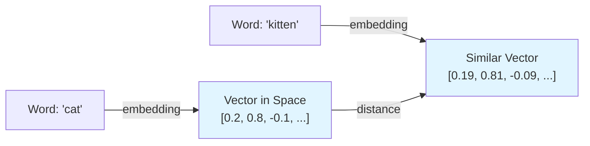
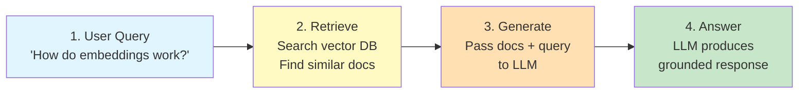

# Lessons Project — Governing Principles & Development Guidelines

**Scope:** This document governs every lesson produced under this project. A "lesson" is a self-contained learning unit made of a notebook (`.ipynb`) and a companion markdown file (`.md`), plus any supporting files the lesson genuinely needs. These principles apply to every lesson, every author, every time — they are the definition of "done" and "consistent" for this catalog.

**Amendments:** If a principle stops making sense for a real lesson, that's a signal to revise this document, not to quietly break the rule. Propose the change, update this file, note the version/date below.

`v1.0 — initial governing document`
`v2.0 — removed the Lesson Tracker requirement (Excel/CSV gate log) from Section 2 and the Pre-Publish Checklist`
`v2.1 — Mermaid diagrams are now a default requirement for any flow/pipeline/architecture concept in Section 7, not optional`
`v2.2 — every notebook must begin with a single `!pip install` cell (CQ-10) installing all required modules so learners can install dependencies directly`
`v3.0 — every lesson now ships a required assignment file (`lesson-<slug>-assignment.md`) with knowledge-check exercises and an answer key (UX-7)`
`v4.0 — Testing Standards removed from this document; the five-gate validation workflow now lives in AGENTS.md, with TEST.md as the companion testing guide`
`v5.0 — CQ-1 line limits are now a reference/scoping guideline, not a strict compliance cap; learners may exceed where scope genuinely requires it, per the change agreed in AGENTS.md`
`v6.0 — lesson structure reduced to 11 sections: Lesson Title replaced by Explanation of Topic, Optional Exercise removed, Prerequisites and Environment Setup made optional; Gate 4 now tests the assignment file`
`v6.1 — Section 1 (Explanation of Topic) must use simple fundamental language, bullet points, at least one everyday example, and a simple diagram`
`v6.2 — every complex code step gets a dedicated explainer, plus a diagram when the step involves a flow, branching, or data changing shape (CQ-11)`
`v6.3 — diagrams capped at 7 blocks (split into parts if larger); every logical code block starts with a plain-language comment (CQ-2)`
`v6.4 — UX-2 expanded: active voice, "we"/"you", simple words, and a warm, human tone throughout the lesson`
`v7.0 — "lab" renamed to "lesson" throughout, including file names (`lesson-<topic-slug>.*`)`

---

## 1. The Canonical Lesson Structure

**Lesson file formats:** Every lesson consists of:
- A **markdown file** (`.md`) — the narrative, instructions, and explanations (required for all lessons)
- A **notebook file** — either `.ipynb` (Jupyter) OR `.py` (Python script with comments/markdown as docstrings)
- An **assignment file** (`lesson-<topic-slug>-assignment.md`) — a set of exercises that let learners test their knowledge after completing the lesson (required for all lessons)
- Any supporting files genuinely needed (data files, config, etc.)

A `.py` file is useful for lessons focused on script/module development rather than exploration. Use `.ipynb` for exploratory, visual, or step-by-step learning; use `.py` for clean, production-like code lessons. Both follow the same 11-section structure.

Every lesson's `.md` file follows this section order, exactly. A learner who's done three lessons should be able to navigate a fourth without re-learning where things live.

| # | Section | What goes here | Length guidance |
|---|---------|----------------|------------------|
| 1 | **Explanation of Topic** | A simple, fundamental introduction to the topic — what it is and why it matters — written so a newcomer understands it on first read: plain words, bullet points, at least one everyday example, and a simple diagram | 1–2 framing sentences, then bullets, an example, and one diagram |
| 2 | **Problem Statement / Use Case Overview** | What real problem this lesson solves, in plain terms | 3–6 sentences |
| 3 | **Input** | What data goes in, format, source (sample/synthetic/real), size | Short paragraph or bullets |
| 4 | **Processing** | What happens to the data — the pipeline/steps at a conceptual level | Short paragraph or bullets |
| 5 | **Output** | What the learner should see when it works — describe it concretely | Short paragraph, screenshot/sample output encouraged |
| 6 | **Tech Stack** | Every library, model, API, and service used, with version | Bullet list |
| 7 | **Underlying Concepts** | The theory needed to understand *why*, not just *how* | **Suggested pages: 2** (may exceed if the content genuinely requires it) |
| 8 | **Prerequisites** *(Optional)* | Background knowledge, accounts/API keys needed | Bullet list |
| 9 | **Environment / Dependencies Setup** *(Optional)* | Exact steps to get a clean environment running | Copy-pasteable commands |
| 10 | **Step-wise Development Instructions** | The actual build, in code blocks, each explained (see Code Quality below) | Bulk of the lesson |
| 11 | **What We Learnt** | Recap of concepts and skills, tying back to Section 7 | 4–8 bullets |

The title is the document's top-level heading above Section 1 — short, descriptive, and matching the file name.

**Section 1 is written for easy understanding.** Start from fundamentals and assume no prior knowledge of the topic:
- **Simple language** — short sentences, everyday words; define any unavoidable term in one line.
- **Bullet points** — break the explanation into short points (one idea each) instead of dense paragraphs.
- **At least one example** — a concrete, everyday example or analogy that makes the idea tangible (e.g., "an embedding is like GPS coordinates for meaning").
- **A simple diagram** — one small Mermaid diagram (see Section 5) showing the core idea at a glance; keep it to 7 blocks or fewer. Detailed pipeline/architecture diagrams belong in Section 7.

Sections 1–7, 10, and 11 are required in every lesson. Sections 8 and 9 are optional: include them when there is something to say, and omit the heading entirely when there isn't. Section 9 is required for `.py` script lessons, since a script has no `!pip install` first cell (CQ-10) to carry the setup.

---

## 2. Code Quality Principles

### Universal Code Quality Rules (Apply to All Difficulty Levels)

**CQ-1. Line limit scales by difficulty level (reference, not a hard cap).**
This is a teaching constraint, not a style preference — beyond the reference ceiling for your difficulty level, a learner tends to lose the plot. The line limits are a **reference for scoping and calibration, not a strict compliance threshold**: if the real build genuinely needs more lines, it may exceed the ceiling. Prefer splitting into a numbered lesson series (`Lesson 2a`, `Lesson 2b`...) when the content naturally divides, but do not stretch or truncate a notebook just to hit the limit. Reference line limits by difficulty: Beginner 80–110, Intermediate 110–150, Advanced 150–180 (see below).

**CQ-2. Every code block is explained, not just labeled.**
Each block in Section 10 is preceded or followed by markdown explaining *what it does and why it's there*. Inside the code, every logical block (a group of lines doing one job) starts with a comment explaining it in easy, everyday words. Explanation depth varies by difficulty level (see below). Assume the learner may not know the library, not just the concept.

**CQ-3. One logical step per cell.**
Load data, chunk it, embed it, store it, query it — each gets its own cell. This lets a learner run and inspect incrementally instead of debugging a wall of code.

**CQ-4. No unexplained magic.**
If a helper function or library call hides real complexity (a `.fit()`, a chained API call, a config object with many fields), the markdown explains what it's abstracting. A learner should never have to go read external docs just to understand what a line in *this* lesson does.

**CQ-5. Consistent, idiomatic style.**
Standard formatting for the language (PEP8 for Python, etc.), descriptive variable names (`chunked_docs`, not `x2`), and no dead code left in from earlier drafts.

**CQ-6. Reproducible by construction.**
Dependency versions are pinned (Section 6 and the setup step, Section 9). No reliance on hidden local state, undocumented files, or "works on my machine" steps.

**CQ-7. Secrets are never hardcoded.**
API keys and credentials are read from environment variables or a `.env` file, with a placeholder and a one-line instruction for how the learner supplies their own.

**CQ-8. Restart-and-run-all always works.**
A notebook must run top to bottom in a fresh kernel with no manual steps skipped or reordered. This is the single most common way lessons silently rot — enforce it every time, not just at first publish.

**CQ-9. Minimize helper functions — use inline code instead.**
Every helper function you define requires learners to understand what it does, often by reading code that's separated from where it's used. Where possible, write code inline even if it's slightly longer. Only use a helper function if (a) it's called multiple times in the lesson, or (b) it abstracts a concept that's important to teach separately. Inline code is harder to write but easier for learners to follow and modify.

**CQ-10. Every notebook starts with a `!pip install` cell.**
The first code cell installs every module the lesson needs in a single line — `!pip install <module1> <module2> ...` — with pinned versions, so a learner can run the first cell and install everything directly. This mirrors Section 9 but makes the notebook runnable from a fresh kernel without reading markdown first.

**CQ-11. Every complex step gets an explainer — and a diagram if required.**
A step is complex when a learner can't follow it from a one-line description: several operations chained together, a non-obvious algorithm or formula, a loop or branch with more than one path, data changing shape (e.g., text → chunks → vectors), or several components talking to each other. Every such step in Section 10 gets a dedicated explainer in the markdown right before it, written as bullet points:
- **Input** — what goes into the step (with its shape or type).
- **What happens** — the operations in order, in plain words.
- **Output** — what comes out (with its shape or type).
- **Why** — why this step is needed at this point in the build.

If the step involves a flow, branching, data changing shape, or components interacting, add a small Mermaid diagram (see Section 5) alongside the explainer. Keep it focused on that one step — the whole-pipeline diagram belongs in Section 7. Simple steps (a single import, reading a file, printing a value) need only CQ-2's short explanation.

---

### Code Quality by Difficulty Level

The rules above apply to all lessons. These standards scale the *depth* and *verbosity* of explanation by who the learner is.

#### Beginner Lessons

**Target:** Learner is new to the core concept, may lack background in the subject domain, needs hand-holding.

**Line limit (reference, not hard cap):** 80–110 lines (tighter than intermediate/advanced).

**Explanation style:**
- Every code block preceded by a prose explanation of what you're about to see.
- Inline comments on almost every line or logical pair of lines.
- More time spent explaining *why* a line exists than what it does — context-setting matters here.
- Library calls explained at the surface level: what does `.fit()` do? The notebook should say, not defer to library docs.
- Variable names extra-descriptive (`user_query_embedding`, not `q_emb`).

**Code construction:**
- Use high-level libraries and helper functions liberally — the goal is clarity, not showing how to build from first principles.
- Prefer `.fit_transform()` or library abstractions over custom loops when both are viable.
- Error handling is basic but present (try/except for file I/O, API calls).
- No "gotcha" code patterns or Python-specific idioms that require prior language knowledge.

**Example (good beginner code):**
```python
# Load our sample data: 50 short product reviews
# We'll analyze the sentiment (positive/negative/neutral) of each one
reviews = load_reviews_from_csv("data/reviews.csv")
print(f"Loaded {len(reviews)} reviews")

# Initialize the sentiment model — this loads a pre-trained model from Hugging Face
# The model is ~500MB, so this takes ~10 seconds the first time
model = load_sentiment_model("distilbert-base-uncased-finetuned-sst-2-english")

# Run the model on each review and collect the results
sentiments = []
for review_text in reviews:
    result = model(review_text)
    sentiments.append(result)

# Show the results
for review, sentiment in zip(reviews, sentiments):
    print(f"'{review[:50]}...' → {sentiment['label']}")
```

#### Intermediate Lessons

**Target:** Learner knows the basics of the subject, is building real-world skills, can connect concepts across multiple pieces.

**Line limit (reference, not hard cap):** 110–150 lines.

**Explanation style:**
- Code blocks preceded by a markdown paragraph explaining the approach, not the syntax.
- Inline comments on non-obvious lines or complex logic, but not on every line.
- Library calls explained at the *purpose* level: what does this do for the pipeline? (not how to read the docs).
- Variable names concise but unambiguous (`embeddings`, not `e`; `query_vector`, not `qv`).
- Assumes some prior knowledge of the domain (e.g., "vector embeddings" doesn't need a full explanation, just how they're used here).

**Code construction:**
- Mix of library abstractions and custom logic — show the learner where they can swap components.
- Error handling is explicit and instructive (e.g., "if no results, try broadening the search").
- Slightly more sophisticated patterns (list comprehensions, context managers) are fine if explained.
- Performance considerations emerge but aren't the focus.

**Example (good intermediate code):**
```python
# Split documents into overlapping chunks so we don't lose meaning at boundaries.
# We'll use 1024-token chunks with 128-token overlap.
chunked_docs = []
for doc in documents:
    chunks = chunk_text(doc, chunk_size=1024, overlap=128)
    chunked_docs.extend(chunks)

# Embed all chunks using the OpenAI API.
# This batches requests for efficiency (OpenAI can handle up to 50 at a time).
embeddings = embed_batch(chunked_docs, model="text-embedding-3-small", batch_size=50)

# Store chunks + embeddings in Weaviate for semantic search.
# We're using Weaviate's built-in vectorizer bypass — we pre-computed the vectors.
for chunk, embedding in zip(chunked_docs, embeddings):
    store.add_document(content=chunk, vector=embedding)
```

#### Advanced Lessons

**Target:** Learner is experienced in the domain, interested in production patterns and nuance, can handle complexity and wants depth.

**Line limit (reference, not hard cap):** 150–180 lines (can approach ceiling).

**Explanation style:**
- Code blocks preceded by a technical explanation of design decisions — why this approach, what are the tradeoffs, what would you do differently at scale?
- Every logical block still gets a plain-language comment (CQ-2); beyond that, inline comments only on subtle or non-standard patterns.
- Library and architectural patterns assumed known; explanation focuses on *how this lesson applies them*, not basics.
- Variable names follow domain conventions (`doc_id`, `top_k`, `recall@100`).
- Rationale for performance choices, testing strategies, and edge cases is part of the narrative.

**Code construction:**
- Custom implementations shown where they illuminate the concept (e.g., a custom retrieval ranking strategy).
- Error handling is comprehensive — edge cases and failure modes are visible.
- Performance optimization is discussed (batching, caching, indexing considerations).
- Advanced patterns are fair game if they serve the concept (async/await, decorators, metaclasses if relevant).

**Example (good advanced code):**
```python
# Implement a two-stage retrieval + reranking pipeline for high-recall search.
# Stage 1: BM25 for keyword recall, Stage 2: Cross-encoder for semantic precision.
# This trades speed for accuracy — suitable for latency-tolerant use cases like reporting.

def retrieve_and_rerank(query, top_k_bm25=50, top_k_final=10):
    """
    Retrieve candidate docs via BM25 (high recall), then rerank with cross-encoder.
    Args:
        query: user search string
        top_k_bm25: how many candidates to retrieve from BM25
        top_k_final: how many to return after reranking
    """
    # Stage 1: BM25 retrieval — fast, keyword-aware
    candidates = bm25.retrieve(query, k=top_k_bm25)
    
    # Stage 2: Rerank with cross-encoder for semantic relevance
    # Cross-encoders are slower but give better ranking than similarity scores
    scores = cross_encoder.rank(query, [c.text for c in candidates])
    
    # Sort by cross-encoder score and return top-k
    ranked = sorted(zip(candidates, scores), key=lambda x: x[1], reverse=True)
    return [doc for doc, score in ranked[:top_k_final]]
```

---

### Categorizing Lessons by Difficulty & Subject Matter

Use this framework to decide whether a lesson is Beginner, Intermediate, or Advanced.

#### Difficulty Signals

**Beginner if:**
- The concept is a first introduction to a topic (e.g., "What is a vector embedding?", "First steps with RAG").
- Prerequisites are minimal or foundational (Python syntax, basic data structures).
- Implementation uses high-level APIs with minimal custom code.
- Learners need heavy hand-holding through the narrative.
- The goal is *understanding*, not applying in production.

**Intermediate if:**
- The concept assumes some background (e.g., "Building a RAG system" assumes you know what retrieval and generation are).
- Prerequisites include prior lessons or equivalent experience.
- Implementation mixes library abstractions with custom logic to show how pieces fit together.
- The goal is *skill-building* — applying known concepts to a new problem.
- Learners can handle abstraction and connect concepts across multiple pieces.

**Advanced if:**
- The concept is a specialization or optimization of a known topic (e.g., "Scaling RAG with hybrid search and reranking", "Autonomous agent design patterns").
- Prerequisites are substantial (deep knowledge of the domain, familiarity with production systems).
- Implementation shows design decisions, tradeoffs, and patterns used in production code.
- The goal is *mastery* — understanding the *why* behind design choices and how to adapt them.
- Learners are comfortable with complexity and want nuance.

#### Subject Matter Categorization

For a given topic, check these factors to place it on the difficulty scale:

| Factor | Beginner | Intermediate | Advanced |
|--------|----------|--------------|----------|
| **Prior knowledge needed** | Language syntax, basic data structures | Domain fundamentals (e.g., "embeddings exist") | Production experience, advanced domain patterns |
| **Concept novelty** | First time seeing this idea | Applying known idea to a new context | Specialization or optimization of known idea |
| **Code complexity** | Mostly library calls, high-level abstractions | Mix of library + custom, some algorithm logic | Custom implementations, design patterns, tradeoffs |
| **Real-world applicability** | Educational toy; not production-ready | Can be production-ready with scaling | Already production-shaped; focuses on nuance |
| **Typical learner goal** | "I want to understand X" | "I want to build with X" | "I want to optimize/specialize X" |

#### How to Label Lessons

**1. Add a header line under the title (see UX-6)** with the difficulty, time estimate, and prerequisites. This makes self-selection easy for learners.

---

## 3. User Experience Consistency

**UX-1. Structural consistency is non-negotiable.**
Every lesson uses the exact 11-section template in Section 1, in the same order, with the same headings (optional Sections 8 and 9 may be omitted). Consistency here is what lets a learner navigate lesson 12 as confidently as lesson 1.

**UX-2. Consistent voice: active, personal, simple, and human.**
All learner-facing text (the narrative, markdown cells, code comments, and the assignment) reads like a friendly teacher talking to the learner:
- **Active voice.** Say who does what: "We split the text into chunks", not "The text is split into chunks".
- **Talk to the learner.** Use "you" for the learner and "we" for steps you take together ("Now we load the data", "You'll see a table like this"). Never "one might construct..." or "the user should...".
- **Simple words.** Pick the everyday word over the difficult one ("use", not "utilize"; "start", not "initialize" — unless the code calls it that). Keep sentences short.
- **Human tone.** Write the way you'd explain it to a colleague sitting next to you: encouraging, direct, and warm ("Don't worry if this looks odd at first — we'll unpack it next"). No stiff, robotic, or textbook phrasing.
- **Jargon defined.** Any term not obvious to a newcomer gets a one-line plain definition the first time it's used, with the full explanation in Section 7.

**UX-3. Consistent depth of explanation across lessons.**
If one lesson explains code line-by-line, all lessons do. A learner shouldn't get lucky with a well-explained lesson and then hit a sparse one — depth of explanation is a catalog-wide standard, not an author's personal style.

**UX-4. Consistent file naming.**
`lesson-<topic-slug>.ipynb`, `lesson-<topic-slug>.md`, and `lesson-<topic-slug>-assignment.md`, same slug, sitting in the same folder. Predictable naming lets learners (and tooling) navigate the catalog without guessing.

**UX-5. Consistent framing of What We Learnt (Section 11).**
"What We Learnt" always ties back explicitly to the concepts named in Section 7, so the loop closes.

**UX-6. Consistent difficulty and time signaling.**
Add a short header line under the title stating estimated time and prerequisite level (e.g., `~40 min · Intermediate · Requires Lesson 3`), so learners can self-select before committing time.

**UX-7. Every lesson ships with an assignment.**
Every lesson includes a `lesson-<topic-slug>-assignment.md` file of exercises that let learners test their knowledge after completing the lesson. The assignment is **required**: it is a standalone practice sheet of 5–10 exercises scaled to the lesson's difficulty, mixing concept questions, short code tasks, and applied tasks. It ends with an answer key (with brief explanations, not just answers) so learners can self-check. Exercises must be doable from the lesson alone and attemptable without re-running the notebook.

---

## 4. Performance Requirements

**PF-1. Runtime budget: ~30–45 minutes end-to-end, including setup.**
This covers reading, environment setup, and running the code. If a real build exceeds this comfortably, split it into a lesson series rather than letting one lesson run long.

**PF-2. Compute footprint is disclosed upfront.**
Section 6 or 8 states plainly whether the lesson needs a GPU, how much RAM is realistic, and whether it runs fine on a laptop CPU. No learner should discover a hardware requirement halfway through.

**PF-3. Cost is disclosed for anything that isn't free.**
If a lesson calls a paid LLM API or hosted vector DB, state the approximate cost of one full run-through, and default to the cheapest model/tier that still teaches the concept. Free/local alternatives are noted where reasonable.

**PF-4. Data and models are sized to teach, not to impress.**
Use the smallest dataset and lightest model that make the concept visible. Teaching "what is a vector database" doesn't need a million-document corpus — a few hundred rows that a learner can inspect by eye is more valuable than scale for its own sake.

**PF-5. Setup itself is not the bottleneck.**
Dependency installation is one command against one pinned requirements/environment file (Section 9) — not a scattered series of `pip install`s discovered mid-notebook. The notebook's first cell repeats this as a single `!pip install ...` line (see CQ-10) so the lesson runs from a fresh kernel without reading Section 9 first. If setup takes more than a couple of minutes, that's a defect to fix, not a fact of life.

---

## 5. Visualizing Concepts with Mermaid Diagrams

Section 7 (Underlying Concepts) should teach the *why* behind a lesson's code. **Use Mermaid diagrams as the default way to explain any system, flow, relationship, or decision tree in your lessons** — a diagram can make a concept click in a way prose alone can't. Include at least one Mermaid diagram whenever the lesson involves a pipeline, architecture, workflow, or any multi-step process. Treat the diagram as a standard part of the lesson, not an optional extra. Section 1 (Explanation of Topic) always includes one simple overview diagram of the core idea, regardless of topic. In Section 10, complex code steps get their own small diagram where a flow, branch, or data shape change needs to be seen (CQ-11).

### When to Use Mermaid Diagrams

**Default: use a Mermaid diagram when any of the following applies.**

- **System architectures:** Showing how components connect (e.g., "a RAG system: documents → vector DB → retriever → LLM → output").
- **Data pipelines:** Visualizing transformations (e.g., "raw text → chunking → embedding → indexing → search").
- **Decision trees:** Explaining branching logic (e.g., "how does the system decide which tool to call?").
- **Workflows and processes:** Showing sequential or parallel steps (e.g., "retrieval pipeline: BM25 → semantic scoring → ranking").
- **Relationships and hierarchies:** Illustrating connections (e.g., "entity relationships in a knowledge graph").
- **State machines:** Showing states and transitions (e.g., "agent state during multi-hop reasoning").
- **Comparisons:** Side-by-side or flow-based comparisons (e.g., "BM25 vs semantic search vs hybrid").

### When NOT to Use Mermaid

- For trivial concepts (if prose explains it in one sentence, don't diagram it).
- If the diagram would be so complex that it needs more explanation than the prose it replaces.
- For output or results (those belong in Section 5, with actual screenshots or tables).
- For code structure (inline comments in the code itself are clearer).

### How to Add Mermaid to a Lesson

Mermaid diagrams are written in markdown code blocks and render automatically in most markdown viewers (GitHub, GitLab, Jupyter, etc.).

**Basic syntax:**
```markdown
## Understanding Vector Embeddings

Words and phrases can be represented as points in high-dimensional space:



This shows how semantic similarity is measured by vector distance.
```

### Mermaid Diagram Types Useful for Lessons

**1. Flowcharts (graph TB/LR)** — Best for pipelines and workflows
- Use for: data processing, decision flows, system architecture
- Example: Load → Chunk → Embed → Index → Query

**2. Sequence Diagrams** — Best for interactions between components
- Use for: user → system → database flows, API calls, multi-step processes
- Example: User query → Retriever → LLM → Output

**3. State Diagrams** — Best for state machines and agent logic
- Use for: agent states, workflow states, decision outcomes
- Example: Idle → Processing → Retrieving → Generating → Done

**4. Graph Diagrams** — Best for relationships and hierarchies
- Use for: knowledge graphs, concept relationships, module dependencies
- Example: Document → Chunks → Embeddings → Index

**5. Class Diagrams** — Best for object relationships (rarely needed)
- Use for: if your lesson involves OOP concepts worth visualizing

### Best Practices for Mermaid in Lessons

- **Keep it simple — 7 blocks max.** If a diagram needs more than 7 blocks, split it into multiple parts (see `GUIDELINES.md`).
- **Use labels clearly.** Every node should be self-explanatory; don't assume learners will guess what "X" means.
- **Use colors intentionally.** Color coding (input, processing, output, decision) helps learners scan the diagram.
- **Precede with context.** Always explain in prose what the diagram is about before showing it. A diagram without context is confusing.
- **Follow with explanation.** After the diagram, explain the key insight or relationship it illustrates.
- **Make it self-contained.** The diagram should make sense to a learner seeing it for the first time, without reading external docs.

### Example: Good Use of Mermaid in a Lesson

**Section 7 (Underlying Concepts) example:**

```
## How Retrieval-Augmented Generation Works

RAG systems combine retrieval and generation in three steps:



**Why this matters:** Without retrieval, the LLM only knows what's in its training data. By retrieving relevant documents first, RAG lets the LLM answer questions about *your* data, not just generic knowledge.

### Testing Diagrams

When you test your lesson (the five gates in AGENTS.md), verify:
- **The diagram renders.** Open the markdown in GitHub/GitLab/Jupyter and confirm it displays.
- **The diagram is accurate.** Does it truthfully represent the concept? Ask your reviewer: "Does this diagram match how the code actually works?"
- **The diagram adds clarity.** Could a beginner understand this concept better because of the diagram, or would prose alone be clearer?

---

## 6. Pre-Publish Checklist

Every lesson must clear this list. Test-gate items below are executed per the five-gate workflow in `AGENTS.md`.

- [ ] Follows 11-section template (Section 1, headings intact)
- [ ] File format: `.ipynb` or `.py` + `.md` file (matching slug name)
- [ ] Code near line reference (not a hard cap): Beginner ≤110, Intermediate ≤150, Advanced ≤180 — exceed only where scope genuinely requires it
- [ ] Every code block explained; every logical block starts with a plain-language comment
- [ ] Text uses active voice, "we"/"you", simple words, and a human tone (UX-2)
- [ ] Every complex step has an explainer (input, what happens, output, why), plus a diagram where required (CQ-11)
- [ ] Helper functions minimized — inline code preferred
- [ ] Runs clean in fresh environment (Gate 1 passes)
- [ ] Output verified against Section 5 (Gate 2 & 3 pass)
- [ ] Assignment exercises attempted and answer key verified (Gate 4 passes)
- [ ] Second person reviewed end-to-end (Gate 5 passes)
- [ ] File names follow `lesson-<topic-slug>.{ipynb|py}` and `lesson-<topic-slug>.md`
- [ ] Difficulty header + time estimate under title
- [ ] Compute/cost requirements disclosed
- [ ] Section 1 uses simple language and bullet points, with at least one example and a simple diagram
- [ ] Mermaid diagram present for any pipeline/flow/architecture concept in Section 7, and renders correctly
- [ ] No diagram exceeds 7 blocks (larger ones split into parts)
- [ ] First code cell runs `!pip install` for all required modules
- [ ] Assignment file `lesson-<topic-slug>-assignment.md` exists with exercises and an answer key

---

## Governance

This constitution supersedes any ad hoc convention adopted for an individual lesson. Where a specific lesson's plan conflicts with a principle above, the principle wins unless this document is amended first.

**Amendment process:** A change to any principle requires (1) a written rationale for the change, (2) review by a second person before it's adopted, and (3) an explicit compatibility note on whether already-published lessons now violate the amended principle and, if so, a remediation plan (re-publish, flag, or grandfather with a stated reason).

**Versioning policy:** This document is versioned independently using semantic versioning (`MAJOR.MINOR.PATCH`):
- **MAJOR** — a principle is removed or redefined in a way that invalidates previously compliant lessons.
- **MINOR** — a new principle or materially expanded rule is added.
- **PATCH** — wording, clarification, or non-semantic correction.

Each amendment updates the version footer below and MUST be accompanied by a summary of what changed.

**Compliance review:** The Pre-Publish Checklist (Section 6) is the enforcement point. Any lesson that fails a checklist item is not published until it passes.

**Version**: 7.0.0 | **Ratified**: 2026-08-05 | **Last Amended**: 2026-10-16
