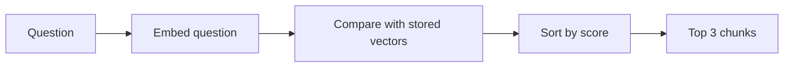
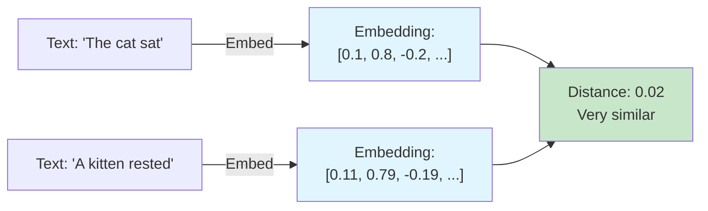
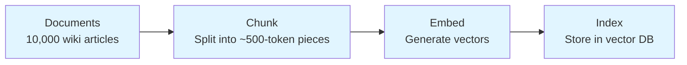
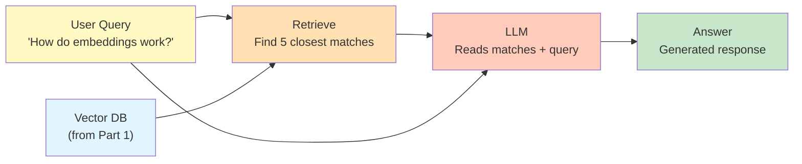
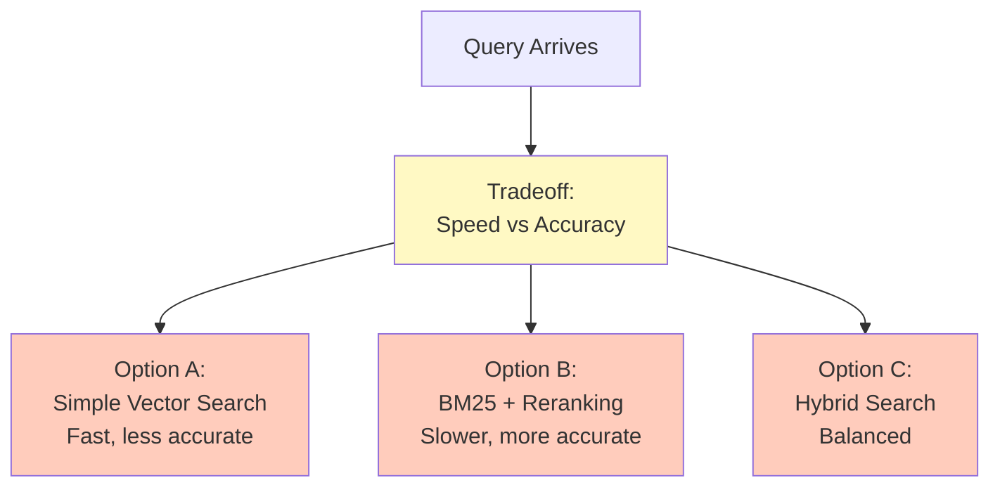
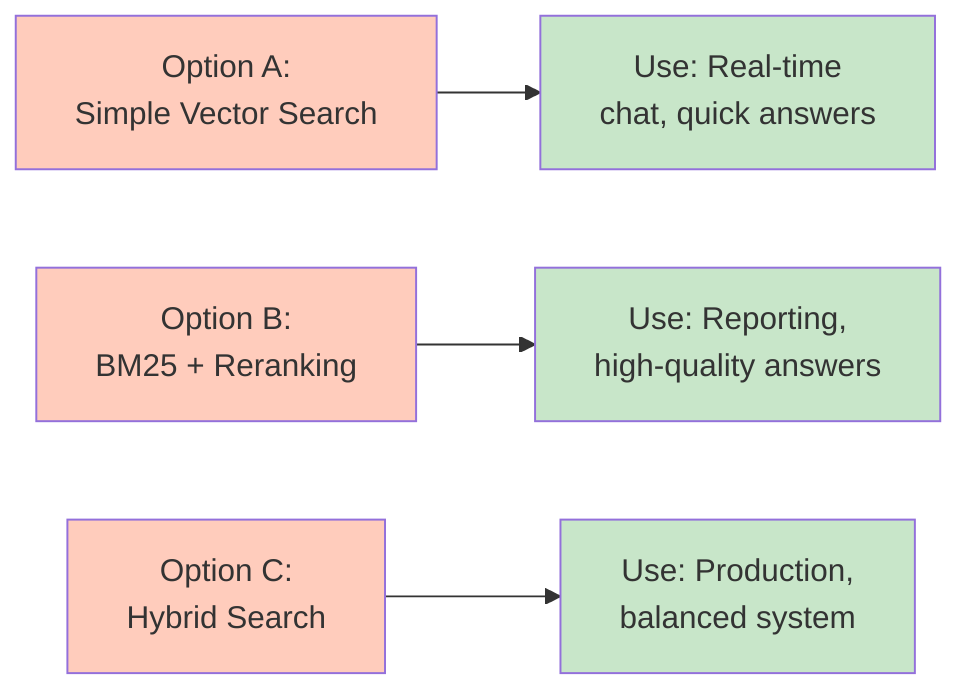

# Development Guidelines — How to Actually Build a Lesson

`CONSTITUTION.md` defines the rules. This document is the practical companion —
concrete steps, examples, and things to watch out for while you're actually
writing a lesson. If something here ever seems to contradict the constitution, the
constitution wins; flag it so this doc can be fixed.

## Quick Start: Building a Lesson in 6 Steps

1. **Scope it before you write code.** Choose notebook format (`.ipynb` for exploratory/visual, `.py` for production-like code). Difficulty level sets a line reference: Beginner ≤110, Intermediate ≤150, Advanced ≤180. These are references for scoping, not hard caps (CQ-1) — exceed only where scope genuinely requires it. Plan a series split if the content naturally divides, but don't truncate a notebook just to hit the number.

2. **Draft Sections 1–9 first.** Explanation of topic, problem, input/processing/output, tech stack, concepts, and (if needed) prerequisites and setup. Do this in markdown before coding.

3. **Build code one step per cell/section.** Load → transform → embed → store → query. Each step is separate, explained as you go.

4. **Write the assignment file (`lesson-<slug>-assignment.md`)** with exercises that test the lesson's key concepts, plus an answer key. Attempt every exercise yourself before shipping.

5. **Restart & Run All in clean environment.** Fresh venv/container built from your Section 9 instructions (or the first `!pip install` cell) only.

6. **Walk the Pre-Publish Checklist**, item by item, before shipping.

## Writing Voice: Simple, Active, Human

Every sentence a learner reads — the narrative, markdown cells, code comments,
and the assignment — should sound like a friendly teacher, not a textbook
(UX-2).

- **Use active voice.** Say who does the action.
- **Use "we" and "you".** "We" for steps you and the learner take together;
  "you" when speaking to the learner directly.
- **Choose simple words.** If there's an everyday word, use it. Short sentences
  beat long ones.
- **Sound human.** Be warm and encouraging, admit when something looks
  confusing, and tell the learner what's coming next.

| Instead of this | Write this |
|-----------------|------------|
| The dataset is loaded and preprocessed. | We load the data and clean it up. |
| One must initialize the client prior to invocation. | First, we set up the client so we can call it. |
| It should be noted that the output is non-deterministic. | Heads up: you might get slightly different answers each time you run this. |
| Utilize the function to facilitate retrieval. | We use this function to find the right chunks. |
| The embedding is computed by the model. | The model turns each chunk into a list of numbers. |
| This approach is suboptimal at scale. | This works great for small data, but it slows down as your data grows. |

**Quick self-check:** read a paragraph out loud. If it sounds like something
you'd never say to a person, rewrite it.

## Writing Each Section Well

- **Explanation of Topic:** Explain the topic from the fundamentals, for
  someone meeting it for the first time — what it is and why it matters —
  before any problem or code. The deeper theory belongs in Underlying Concepts.
  - **Keep the language simple:** short sentences, everyday words, and a
    one-line definition for any term you can't avoid.
  - **Use bullet points:** one idea per bullet, after at most 1–2 framing
    sentences. No dense paragraphs.
  - **Give at least one example:** an everyday analogy or a concrete
    before/after makes the idea tangible.
  - **Add a simple diagram:** one small Mermaid diagram (7 blocks max)
    that shows the core idea at a glance.

  Example (topic: vector embeddings):

  ````markdown
  ## 1. Explanation of Topic

  Computers can't compare meaning directly — they compare numbers. Embeddings
  turn text into numbers so meaning can be compared.

  - **What it is:** an embedding is a list of numbers that represents the
    meaning of a piece of text.
  - **Key idea:** texts with similar meaning get similar numbers.
  - **Why it matters:** it lets you search by meaning, not exact words.

  **Example:** think of GPS coordinates. "Café" and "coffee shop" land close
  together on the map; "car engine" lands far away.

  ```mermaid
  graph LR
      A["'coffee shop'"] --> E[Embedding model]
      B["'café'"] --> E
      E --> V["Similar numbers → close together"]
  ```
  ````
- **Problem Statement:** Ground it in a real scenario ("a support team needs to
  search 10,000 past tickets by meaning, not keyword") rather than an abstract
  capability ("demonstrates semantic search"). Learners retain concepts better
  when they're anchored to a use case.
- **Underlying Concepts (suggested 2 pages):** Write it last, after the lesson is built —
  it's easier to explain a concept once you've implemented it. Use one concrete
  analogy if the concept is abstract (e.g., "a vector embedding is like a GPS
  coordinate for meaning"). Cut anything a learner doesn't need to understand
  *this* lesson's code.
- **Tech Stack:** List exact versions, not just names (`langchain==0.2.1`, not
  "LangChain"). If you're not sure why a version matters, it's because an
  untested version bump is exactly what breaks a lesson six months later.

## Writing the Assignment File

Every lesson ships with `lesson-<topic-slug>-assignment.md` — a standalone set of exercises that lets learners test what they just learned, without re-running the lesson.

**What goes in it:**
- **5–10 exercises**, scaled to difficulty (Beginner: 5–7, Intermediate: 7–9, Advanced: 9–10).
- **A mix of question types:** concept questions ("What does an embedding capture?"), short code tasks ("Write a function that chunks text into ~500-token pieces"), and applied tasks ("Given the RAG pipeline, add a reranker step").
- **An answer key at the end** with brief explanations, not just answers — learners self-check, so the *reasoning* matters.
- **References to the lesson, not repeats.** Point exercises back at the relevant section ("see Section 7") instead of re-explaining the concept.

**Rules:**
- Exercises must be **doable from the lesson alone** — no outside reading required.
- Attempt **every exercise yourself** before publishing and verify the answer key (this is Gate 4).
- Learners can attempt the assignment **without re-running the notebook**; any code-based exercise should run in a scratch file.

## Choosing and Signaling Difficulty Level

Before you write a line of code, decide: is this a Beginner, Intermediate, or
Advanced lesson? This shapes everything else.

**Ask yourself:**
- Is this the *first* time a learner will see this concept, or are they building
  on existing knowledge?
- How much domain background do they need to understand the code?
- Is the code mostly high-level library calls (Beginner) or a mix of custom +
  library (Intermediate) or mostly custom + design decisions (Advanced)?
- What's the realistic learner goal — understanding, skill-building, or mastery?

**Examples of the decision:**
- "What are embeddings?" → Beginner (first exposure, heavy explanation).
- "Building semantic search" → Intermediate (assumes you know what embeddings
  are, focuses on the build).
- "Optimizing embedding retrieval at scale" → Advanced (assumes you've built
  semantic search, focuses on production patterns).

**Once you decide, use it:**
- **Line reference:** Beginner ≤110, Intermediate ≤150, Advanced ≤180 (reference, not a hard cap)
- **Explanation density:** Beginner more prose/comments; Intermediate balanced; Advanced concise
- **Code style:** Beginner avoids fancy Python; Intermediate clear idioms; Advanced shows sophisticated patterns if instructive
- **Library usage:** Beginner high-level abstractions; Intermediate mix; Advanced custom implementations where instructive
- **Helper functions:** Minimize. Write inline unless called multiple times or teaching a separate concept
- **File format:** `.ipynb` for exploratory lessons; `.py` for production-like code lessons

**Then label it:**
```
Difficulty: Beginner | ~30 min | No prerequisites
```
Be honest about your target level.

## Code Style, With Examples

### Comment Every Logical Block

Every logical block of code — a group of lines that does one job together
(load the data, clean a column, build the prompt, call the model) — starts with
a comment that says what the block does **in easy, everyday words**.

- **One comment per block, above it.** Not just on tricky lines — every block.
- **Plain words, not jargon.** Write it so a newcomer could read only the
  comments and still follow the story of the code.
- **Say what and why, not the syntax.** "Keep only reviews with a rating" beats
  "dropna on rating column".
- Extra inline comments on subtle lines are still welcome on top of this.

**Example:**
```python
# Load the customer reviews from the CSV file into a table.
reviews = pd.read_csv("data/reviews.csv")

# Throw away reviews that have no star rating — we can't learn from them.
reviews = reviews.dropna(subset=["rating"])

# Turn star ratings into simple labels: 4–5 stars is "positive", the rest "negative".
reviews["label"] = reviews["rating"].apply(lambda r: "positive" if r >= 4 else "negative")
```

**Weak comment (describes syntax, not intent):**
```python
# loop through docs
for doc in docs:
    chunks.append(splitter.split(doc))
```

**Better (explains why, at the learner's level):**
```python
# Split each document into ~500-token chunks. Embedding models have a context
# limit, and smaller chunks give more precise retrieval later — a full 20-page
# doc embedded as one vector would blur together unrelated sections.
for doc in docs:
    chunks.append(splitter.split(doc))
```

**Weak cell granularity (several steps buried in one cell):**
```python
docs = load_docs("data/")
chunks = chunk_documents(docs)
embeddings = embed(chunks)
store.add(embeddings)
```

**Better (one step per cell, each with its own explanation above it):**
Split the four lines above into four cells, each preceded by a sentence
explaining that specific step. If a learner wants to inspect `chunks` before
embedding, they should be able to run to that point and stop.

### Explaining Complex Steps (CQ-11)

A one-sentence explanation is enough for a simple step. A **complex** step
needs a dedicated explainer, and a diagram if required.

**Is this step complex?** Yes if any of these apply:
- Several operations are chained in one step.
- It uses a non-obvious algorithm, formula, or library call.
- It has a loop or branch with more than one path.
- The data changes shape (text → chunks → vectors → scores).
- Several components interact (model, database, API).

**Explainer format** — bullet points right before the code cell:
- **Input:** what goes in, with its shape or type.
- **What happens:** the operations in order, in plain words.
- **Output:** what comes out, with its shape or type.
- **Why:** why the build needs this step here.

**Add a diagram if** the step has a flow, a branch, or data changing shape.
Keep it to 7 blocks or fewer and about this step only.

**Example (retrieval step):**

````markdown
### Step 5 — Find the most relevant chunks

- **Input:** the user's question (a string) and the stored chunk vectors.
- **What happens:**
  - We turn the question into a vector with the same embedding model.
  - We compare that vector with every stored chunk vector (cosine similarity).
  - We sort the chunks by score and keep the top 3.
- **Output:** you get a list of 3 chunks, most relevant first.
- **Why:** the language model can only read a few chunks, so we hand it the
  ones most likely to contain the answer.


````

## Minimizing Helper Functions

Every helper function creates a cognitive load on the learner — they see a call
like `chunked_docs = chunk_documents(docs)` and need to either (a) find and read
the function definition, or (b) trust that it does what the name suggests. Both
interrupt the learning flow.

**Default: inline code.** Even if it's 5 lines, write it out:

```python
# Split each document into chunks
chunked_docs = []
for doc in documents:
    doc_chunks = doc.split_by_tokens(max_tokens=512)
    chunked_docs.extend(doc_chunks)
```

This is clearer for a learner than:

```python
chunked_docs = chunk_documents(documents)  # What does this do? Go read the function...
```

**Use a helper function only if:**
- It's called **multiple times** in the lesson (e.g., `process_text()` used in three different cells).
- OR it teaches a **separate concept** worth isolating (e.g., a custom scoring function that's the whole point of an advanced lesson).

**For helper functions you do define:**
- Define it early (top cells), with a clear docstring.
- Use it multiple times so the learner sees why you abstracted it.
- Explain in markdown *why* you extracted this into a function (usually "we use this pattern three times, so...").

## First Cell: `!pip install` the Dependencies

**Every notebook's first code cell installs everything the lesson needs in one line**, so a learner can install all modules directly by running the first cell:

```python
!pip install openai==1.35.0 langchain==0.2.5 weaviate-client==4.6.2
```

- **One line, all modules.** Don't scatter installs through later cells — running the first cell leaves everything ready.
- **Pin versions** exactly as in Section 6 / Section 9 so the notebook and the setup instructions never drift.
- **`.py` script lessons:** a script can't run `!pip` — keep installs in Section 9 via `requirements.txt` + `pip install -r requirements.txt`, and note that in the checklist.
- **Explain the cell.** One sentence right under it, e.g., "This installs the exact versions of every library used in this lesson."
- **Gate 2 test includes it.** When you `Restart & Run All`, the `!pip install` cell runs first and must succeed in a fresh environment (which your Gate 1 environment is).

## Testing, in Practice

The Constitution calls for five validation gates; `AGENTS.md` is the
authoritative source for the exact gate steps (Gate 1 Fresh Environment → Gate 5
Reviewer Walkthrough) and the `TEST.md` framework supplies the test-case design.
Walk the gates in order, one at a time — don't skip a gate or test out of order;
each depends on the previous one passing. What follows is the practical color
and the failure modes each gate tends to trip on, not a replacement for the
steps in `AGENTS.md`.

### Gate 1: Fresh Environment Setup
Start with a truly clean slate. This is where most lessons fail silently:
- **Common failure modes:** Missing a dependency, forgetting to pin a version,
  assuming a system library is pre-installed, or hardcoding a path that only
  exists on your machine.
- **Example failure and fix:**
```
Author tests, runs: pip install langchain weaviate-client
Gate 1 test runs: pip install -r requirements.txt
Result: ModuleNotFoundError: No module named 'weaviate'

Fix: Add weaviate-client to requirements.txt (it wasn't pinned),
re-test Gate 1. Now it passes.
```

### Gate 2: Restart & Run All
For `.ipynb`: Kernel → Restart & Clear Output, then Cell → Run All. For `.py`:
`python script.py`. Watch it run without touching anything. **Common failures:**
variables/imports from earlier cells missing, hardcoded paths (use relative
paths, e.g. `Path(__file__).parent / "data/reviews.csv"`), and dependencies not
pinned in Section 9.

### Gate 3: Output Verification
Look at what the notebook actually printed and compare to Section 5. The usual
trap is writing Section 5 from memory ("should show a table") when the real
output differs. **Fix:** run a fresh Gate 2 to get actual output, screenshot it,
and update Section 5 to match what really happens.

### Gate 4: Assignment Test
Actually attempt every exercise in the assignment file — don't just think "this
should work."

**Example: Gate 4 test**
```
Exercise 4 says: "Write a function that chunks text into ~500-token pieces"

What Gate 4 does:
1. Write the function in a scratch file using only what the lesson taught
2. Run it on sample text
3. Compare against the answer key

What Gate 4 finds:
- The lesson never showed how to count tokens, only characters
- The answer key uses a tokenizer the lesson doesn't install

What you do:
- Document this in your test report
- Either add token counting to Section 10, or reword the exercise to
  "~2,000-character pieces" and update the answer key
```

**Why this matters:** An exercise that sounded good but can't be solved from the
lesson is worse than no exercise. A learner who follows your instructions and hits a
wall blames the lesson.

### Gate 5: Reviewer Walkthrough
Have someone else (not you) do all four gates above — they read the markdown
without running code first (catches confusing explanations), set up fresh (Gate
1), run the notebook (Gate 2), and attempt the assignment (Gate 4).

**What reviewers often find that authors miss:** a step that feels obvious to
you but is unexplained; an unstated assumption ("you know what embeddings are");
a typo in Section 9 that didn't break on your machine because you already had
the package; an explanation too terse for the stated difficulty level. Treat
reviewer feedback as data — they're showing you the gaps between what's in your
head and what's on the page.

---

## Testing at Different Difficulty Levels

**Beginner lessons:**
- Reviewer should be someone who knows the programming language but not the domain. Can they follow the code without constantly checking library docs?
- Ask reviewer: "Was every concept explained before it was used?" and "Did you ever feel lost?"

**Intermediate lessons:**
- Reviewer should know the domain but maybe not have built this exact thing before. Can they understand the design choices? Could they adapt this to their own project?
- Ask reviewer: "Did the assignment exercises feel realistic?" and "Would you know what to change if you wanted to use a different model/library?"

**Advanced lessons:**
- Reviewer should be experienced in the domain. Are the tradeoffs visible? Could they extend this to production?
- Ask reviewer: "Are the limitations clear?" and "Could you take this and scale it?"

## Common Pitfalls

**Across all difficulty levels:**
- **Unattempted assignment.** The single most common gap — exercises and answer
  keys are the content most likely to be written from assumption rather than
  verified.
- **Copy-pasted `requirements.txt` from another lesson** without checking whether
  every pinned version is actually still needed or still compatible.
- **Debug prints and dead code left in** from earlier iterations of the build.
- **Underlying Concepts stretching well past the suggested 2 pages** because it's tempting to explain
  everything adjacent to the topic, not just what this lesson needs.
- **Cost/hardware requirements omitted** because the author's own machine
  already had a GPU or an API key with credits, so the gap wasn't visible to
  them.
- **Required section skipped.** Only Sections 8 and 9 are optional; every other
  heading must be present, and a missing one looks like a mistake.

**Specific to difficulty level:**

*Beginner lessons:*
- **Over-explaining obvious things** — "append adds an item to a list" — wastes
  space on facts a learner in a programming context already knows. Focus on the
  domain, not the syntax.
- **Under-explaining domain concepts** — "now we embed the text" without saying
  what an embedding *is* or why you'd want one. Beginners are new to the topic,
  not necessarily new to programming.
- **Mixing difficulty levels.** If you label it Beginner but use advanced Python
  idioms or assume they've done prior lessons, learners will get lost. Stay in one
  lane.

*Intermediate lessons:*
- **Too much hand-holding.** Once a learner knows the basics, over-explaining
  feels condescending and wastes their time. Trust them to connect dots across
  multiple cells.
- **Not enough context.** Intermediate lessons should still explain *why* design
  choices matter — "we use batch_size=50 because the API has limits" is useful
  context, not fluff.

*Advanced lessons:*
- **Underestimating the baseline.** If you label it Advanced, don't spend three
  cells on "here's how to load a CSV" — assume they've built things before.
- **Too little explanation of tradeoffs.** The whole point of an advanced lesson is
  understanding the *why*. If you skip that, it's just code, not teaching.
- **Forgetting the learner is still learning.** "Advanced" doesn't mean "no
  explanation." It means explaining at a higher level of sophistication.

## Using Mermaid Diagrams to Explain Concepts

Section 7 (Underlying Concepts) is your chance to explain the *why* and *how* in theory before diving into code. **A well-placed diagram can save 500 words of explanation.**

### Default: Use a Mermaid Diagram

**Plan on including at least one Mermaid diagram in every lesson.** A lesson that explains any flow, pipeline, architecture, workflow, or relationship in prose should convert that into a diagram. Ask yourself:
- Can I explain this concept better as a flow, architecture, or relationship than as prose?
- Would a learner benefit from seeing how pieces connect visually?
- Is there a pipeline, workflow, or decision tree involved?

If yes to any of these — and that will be most lessons — use Mermaid. Only skip it when the concept is trivial enough that a one-sentence explanation suffices.

### Example: Vector Embeddings (Beginner Lesson)

**Weak explanation (prose only):**
> Vector embeddings are numerical representations of text. They capture semantic meaning so that similar texts have similar embeddings. An embedding is computed by an embedding model like OpenAI's `text-embedding-3-small`.

**Better explanation (prose + diagram):**

> Vector embeddings are numerical representations of text that capture semantic meaning. Similar texts produce similar embeddings.



> Notice the embeddings are close (small distance = similar meaning), even though the text is phrased differently. This is what makes semantic search possible — finding relevant documents by meaning, not just keywords.

### Example: RAG Pipeline (Intermediate Lesson)

**Problem:** Explaining RAG is multi-step and learners need to understand the flow.
The full pipeline has 8 blocks — over the 7-block limit — so it is split into
two parts at its natural seam: preparing the documents, then answering a question.

**Part 1 — Prepare the documents (done once):**



**Part 2 — Answer a question (every time a user asks):**



**Part 1 (blue):** Prepare your documents once and store them. **Part 2:** When a user asks a question (yellow), retrieve the relevant chunks (orange); the LLM reads them and answers (green).

### Example: Difficulty Progression (Advanced Lesson)

Show tradeoffs and decision points.

The full picture (query → tradeoff → 3 options → 3 use cases) has 8 blocks, so
it is split in two.

**Part 1 — The choice:**



**Part 2 — Where each option fits:**



This tells the learner: there's no single "best" answer, it depends on your constraints.

### Size Limit: 7 Blocks per Diagram

**A single diagram has at most 7 blocks (nodes).** Past that, learners stop
reading the picture and start decoding it.

- **Count before you publish.** Every box, circle, or decision shape is one
  block. Arrows and labels on arrows don't count.
- **Over 7? Split it into parts.** Break at a natural seam — setup vs. run time,
  one stage vs. the next, the choice vs. its consequences — and label them
  "Part 1", "Part 2", and so on.
- **Link the parts.** Repeat the block where one part hands off to the next
  (e.g., "Vector DB (from Part 1)") so the learner can see how they connect.
- **Introduce each part** with one sentence saying what it covers.

The RAG pipeline and the search-tradeoff examples above are both split this way.

### Checklist: Is Your Diagram Good?

- [ ] Renders in GitHub/GitLab/Jupyter (test it before publishing)
- [ ] 7 blocks max — if more, split into Part 1, Part 2, ...
- [ ] Every node has a clear, understandable label
- [ ] Color coding (if used) is consistent and meaningful
- [ ] Followed by 1–2 sentences explaining what the diagram shows
- [ ] Adds clarity (not just decoration)
- [ ] Matches how the code actually works

---

## Quick-Reference Checklists

### Pre-Building Checklist
Before you write any code:

```
[ ] Difficulty level chosen (Beginner/Intermediate/Advanced)
[ ] Scope estimated — near the Article II line reference? (reference, not a hard cap)
[ ] If too big, split into a series (Lesson 2a, Lesson 2b, etc.)
[ ] Using the 11-section structure from the constitution
[ ] Sections 1–9 drafted (explanation of topic through setup)
[ ] Difficulty header line ready (e.g., "Difficulty: Intermediate | ~40 min")
```

### Testing Checklist (Five Gates)
After you build, test in order — each gate must pass before the next. The
step-by-step procedure for each gate lives in `AGENTS.md` (Gate 1 Fresh
Environment → Gate 5 Reviewer Walkthrough) and the failure modes are above; run
them in that document's order and report PASSED/FAILED per gate.

### Pre-Publish Checklist
The authoritative pre-publish checklist is **Section 6 (Pre-Publish Checklist) of
`CONSTITUTION.md`** — walk it item by item before shipping. It covers structure,
file format, line reference, code explanations, all five gates, file naming,
difficulty header, compute/cost disclosure, Mermaid diagrams, the `!pip install`
first cell, and the assignment file.
