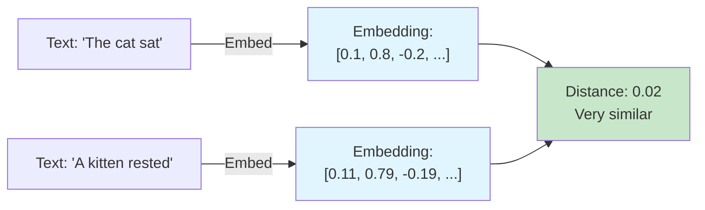
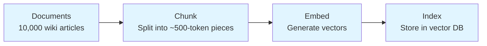
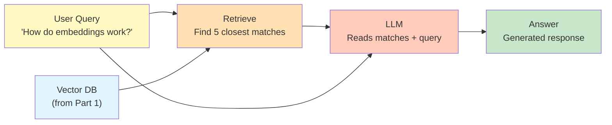
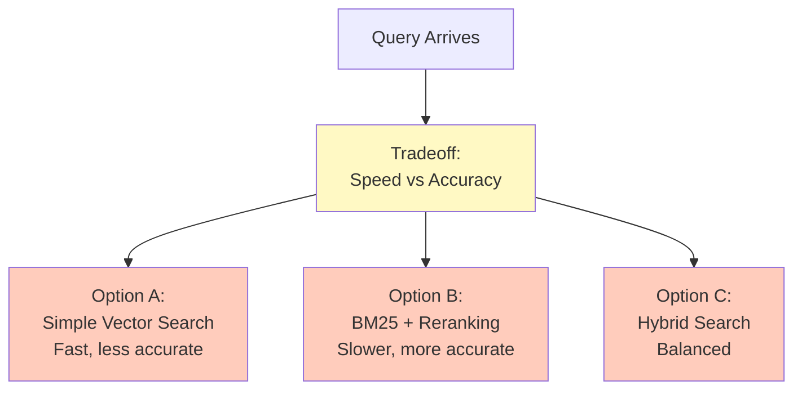
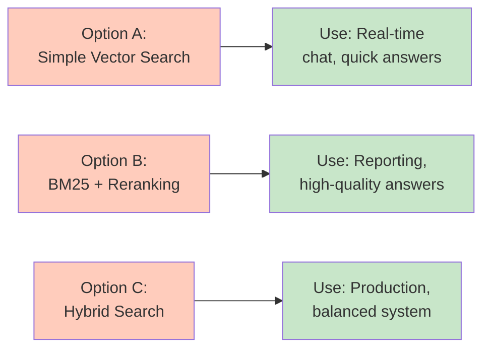

# Development Guidelines — How to Actually Build a Lesson

`CONSTITUTION.md` defines the rules. This document is the practical companion —
concrete steps, examples, and things to watch out for while you're actually
writing a lesson. If something here ever seems to contradict the constitution, the
constitution wins; flag it so this doc can be fixed.

Terms: **"Article N"** means a part of `CONSTITUTION.md`; **"Section N"** means
one of the 11 sections of a lesson's `.md` file; the **code file** is the
lesson's `.ipynb` notebook or `.py` script.

## Quick Start: Building a Lesson in 7 Steps

1. **Scope it before you write code.** Choose notebook format (`.ipynb` for exploratory/visual, `.py` for production-like code). The line reference is about 150 lines of raw code — comments, docstrings, blank lines, and the `!pip` line don't count. It's a reference for scoping, not a hard cap (CQ-1) — exceed only where scope genuinely requires it. Plan a series split if the content naturally divides, but don't truncate a lesson just to hit the number.

2. **Draft Sections 1–6 (and 8–9 if needed) first,** starting from the `.md` skeleton in Article I: What is \<Topic\>?, problem, input/processing/output, tech stack, and any prerequisites and setup. Do this in markdown before coding. Sections 7 and 11 come after the code (step 4).

3. **Build code one step per cell.** Load → transform → embed → store → query. Each code cell is followed by a markdown cell explaining it — and the notebook holds nothing else (see "Notebook Layout" below). Copy each block and its explanation into Section 10 as you go.

4. **Write Sections 7 and 11 once the code works.** It's easier to explain a concept once you've implemented it, and What We Learnt must tie back to Section 7.

5. **Write the assignment file (`lesson-<slug>-assignment.md`)** with exercises that test the lesson's key concepts, plus an answer key. Attempt every exercise yourself before shipping.

6. **Restart & Run All in clean environment.** Fresh venv/container built from your Section 9 instructions (or the first `!pip install` cell) only.

7. **Walk the Pre-Publish Checklist** (Article VI), item by item, before shipping.

## Writing Voice: Simple, Active, Human

Every sentence a learner reads — the narrative, markdown cells, code comments,
and the assignment — should sound like a friendly teacher, not a textbook
(UX-2).

- **Use active voice.** Say who does the action.
- **Use "we" and "you".** "We" for steps you and the learner take together;
  "you" when speaking to the learner directly.
- **Choose simple words.** If there's an everyday word, use it. Short sentences
  beat long ones.
- **Sound human.** Be warm and encouraging, admit when something looks
  confusing, and tell the learner what's coming next.

| Instead of this | Write this |
|-----------------|------------|
| The dataset is loaded and preprocessed. | We load the data and clean it up. |
| One must initialize the client prior to invocation. | First, we set up the client so we can call it. |
| It should be noted that the output is non-deterministic. | Heads up: you might get slightly different answers each time you run this. |
| Utilize the function to facilitate retrieval. | We use this function to find the right chunks. |
| The embedding is computed by the model. | The model turns each chunk into a list of numbers. |
| This approach is suboptimal at scale. | This works great for small data, but it slows down as your data grows. |

**Quick self-check:** read a paragraph out loud. If it sounds like something
you'd never say to a person, rewrite it.

### Spell Out Every Acronym on First Use

The first time an acronym shows up in the lesson, write it out in full with the
acronym in brackets. After that, the short form is fine.

- **Format:** full form first, acronym in brackets — "Large Language Model
  (LLM)", "Application Programming Interface (API)".
- **Wherever it first appears.** That might be the title, Section 1, a code
  comment, or a diagram label. For a diagram, spell it out in the sentence just
  before it.
- **Even the "obvious" ones.** API, CSV, GPU, and JSON are obvious to you, not
  necessarily to the learner.
- **Add a few plain words when the full form doesn't help.** "BM25 (Best Match
  25, a classic keyword-ranking method)" tells the learner more than the
  expansion alone.
- **Once per file.** Learners may open the `.md`, the code file, or the
  assignment on its own, so spell out each acronym again at its first use in
  each of the three files.

| Instead of this | Write this |
|-----------------|------------|
| We'll build a RAG pipeline. | We'll build a Retrieval-Augmented Generation (RAG) pipeline. |
| Send the prompt to the LLM. | Send the prompt to the Large Language Model (LLM). |
| Save the results as a CSV. | Save the results as a Comma-Separated Values (CSV) file. |

**Quick self-check:** search the lesson for each acronym and check that its
first appearance is spelled out in full.

## Real-World Examples for Hard Concepts

This is a UX-2 rule. Every complex or hard concept gets a **short, real-world example** — wherever it
shows up (What is \<Topic\>?, Underlying Concepts, a complex code step, or
the assignment). A good example lets the learner picture the idea before they
read the technical version.

- **Keep it short.** One or two sentences. If the example needs its own
  explanation, it's too long.
- **Make it real-world.** Use things people do or see in daily life — sorting
  laundry, a shopping list, a library shelf, a map, a recipe, a phone's contact
  list, a traffic light.
- **Keep it universal.** The example must make sense to anyone, anywhere. Don't
  tie it to a particular community, nationality, religion, region, or culture:
  - No country-specific sports, festivals, holidays, foods, or traditions.
  - No local currencies, brands, celebrities, politicians, or TV shows.
  - No jokes or references that only one group would get.
- **Match the idea closely.** The example should mirror how the concept actually
  works, not just sound similar. Say where it stops matching if that could
  mislead.

| Concept | Too long / not universal | Short and universal |
|---------|--------------------------|---------------------|
| Embeddings | A long story about a specific national sport's player rankings | Like GPS coordinates for meaning: similar ideas sit close together on the map. |
| Caching | An example built around a particular festival's food preparation | Like keeping your keys by the door so you don't search the house every time. |
| Chunking | A region-specific newspaper layout | Like cutting a long recipe into steps so you can follow one at a time. |
| Overfitting | A reference to one country's exam system | Like memorizing last year's test answers — great on that test, lost on a new one. |
| Queue | A local train or bank custom | Like a line at a ticket counter: first in, first served. |

**Quick self-check:** would a learner on the other side of the world get this
example without looking anything up? If not, swap it for a more universal one.

## Writing Each Section Well

- **What is \<Topic\>? (Section 1):** Name the topic in the heading as a
  plain question — "What is an AI Agent?", "What are Vector Embeddings?" — and
  use the section to answer it. Explain the topic from the fundamentals, for
  someone meeting it for the first time — what it is and why it matters —
  before any problem or code. The deeper theory belongs in Underlying Concepts.
  - **Keep the language simple:** short sentences, everyday words, and a
    one-line definition for any term you can't avoid.
  - **Use bullet points:** one idea per bullet, after at most 1–2 framing
    sentences. No dense paragraphs.
  - **Give at least one example:** a short, real-world, universal example
    makes the idea tangible (see "Real-World Examples for Hard Concepts").
  - **Always add a simple diagram:** one small Mermaid diagram (7 blocks max)
    that shows the core idea at a glance — even when the topic seems simple.

  Example (topic: vector embeddings):

  ````markdown
  ## 1. What are Vector Embeddings?

  Computers can't compare meaning directly — they compare numbers. Embeddings
  turn text into numbers so meaning can be compared.

  - **What it is:** an embedding is a list of numbers that represents the
    meaning of a piece of text.
  - **Key idea:** texts with similar meaning get similar numbers.
  - **Why it matters:** it lets you search by meaning, not exact words.

  **Example:** think of GPS coordinates. "Café" and "coffee shop" land close
  together on the map; "car engine" lands far away.

  ```mermaid
  graph LR
      A["'coffee shop'"] --> E[Embedding model]
      B["'café'"] --> E
      E --> V["Similar numbers → close together"]
  ```
  ````
- **Problem Statement:** Ground it in a real scenario ("a support team needs to
  search 10,000 past tickets by meaning, not keyword") rather than an abstract
  capability ("demonstrates semantic search"). Learners retain concepts better
  when they're anchored to a use case.
- **Underlying Concepts (suggested 2 pages):** Write it after the code is built —
  it's easier to explain a concept once you've implemented it. Give every hard
  concept a short, real-world, universal example (e.g., "a vector embedding is
  like a GPS coordinate for meaning") — see "Real-World Examples for Hard
  Concepts". Cut anything a learner doesn't need to understand
  *this* lesson's code.
- **Tech Stack:** List exact versions, not just names (`langchain==0.2.1`, not
  "LangChain"). If you're not sure why a version matters, it's because an
  untested version bump is exactly what breaks a lesson six months later.

## Writing the Assignment File

Every lesson ships with `lesson-<topic-slug>-assignment.md` — a standalone set of exercises that lets learners test what they just learned, without re-running the lesson.

**What goes in it:**
- **5–10 exercises**, scaled to the lesson's scope (more concepts → more exercises).
- **A mix of question types:** concept questions ("What does an embedding capture?"), short code tasks ("Write a function that chunks text into ~500-token pieces"), and applied tasks ("Given the RAG pipeline, add a reranker step").
- **An answer key at the end** with brief explanations, not just answers — learners self-check, so the *reasoning* matters.
- **References to the lesson, not repeats.** Point exercises back at the relevant section ("see Section 7") instead of re-explaining the concept.

**Skeleton** — copy it for every assignment file:

```markdown
# <Lesson Title> — Assignment

## Exercises

### Exercise 1 — <short name>
<The question or task, in plain words.>

### Exercise 2 — <short name>
...

## Answer Key

### Exercise 1
**Answer:** <the answer, or the working code>

**Why:** <one to three sentences explaining the reasoning>

### Exercise 2
...
```

**Rules:**
- Exercises must be **doable from the lesson alone** — no outside reading required.
- Attempt **every exercise yourself** before publishing and verify the answer key (this is Gate 4).
- Learners can attempt the assignment **without re-running the notebook**; any code-based exercise should run in a scratch file.

## Scoping a Lesson and Signaling Time

Before you write a line of code, get clear on who the lesson is for and what it
covers. This shapes everything else.

**Ask yourself:**
- Is this the *first* time a learner will see this concept, or are they building
  on existing knowledge? Either way, explain every term on first use.
- How much background does a learner need to follow the code? List it in the
  header line and, if useful, in Section 8 (Prerequisites).
- Does the code lean on high-level library calls, custom logic, or design
  decisions? Explain each at the level the Code Quality Standards set.
- What's the realistic learner goal — understanding, building, or optimizing?
  Make the narrative serve that goal.

**Then apply the shared standards:**
- **Line reference:** about 150 lines of raw code (reference, not a hard cap — CQ-1)
- **Explanation density:** a prose explanation after every block, a plain
  comment on every logical block, extra comments on non-obvious lines
- **Code style:** clear idioms only when they serve the concept, explained when used
- **Library usage:** high-level abstractions by default; custom logic where it
  shows the concept or where components can be swapped
- **Helper functions:** Minimize. Write inline unless called multiple times or teaching a separate concept
- **File format:** `.ipynb` for exploratory lessons; `.py` for production-like code lessons

**Then label it** — the header line goes directly under the title:
```
~30 min · Needs: basic Python
```
Be honest about the time and what a learner needs to know first. If the lesson
needs an account, API key, paid service, more than a laptop CPU, or an earlier
part of its series, Section 8 (Prerequisites) is required too.

## Code Style, With Examples

### Notebook Layout: Code, Then Its Explanation

The notebook (or `.py` script) holds **only code and the explanation of that
code**. Everything else — title, header line, Sections 1–9, Section 11 — lives
only in the `.md` file.

```
[code]      !pip install ... (pinned versions)
[markdown]  What this cell installs, in one sentence
[code]      Step 1 — e.g., load the data
[markdown]  What step 1 did and why
[code]      Step 2 — e.g., split into chunks (a complex step)
[markdown]  Explainer: Input / What happens / Output / Why + small diagram
...
```

- **Explanation always comes after the code**, never before it.
- **No other markdown cells** — no title cell, no introduction, no theory, no recap.
- **`.py` scripts:** the same pattern, with each explanation as a comment block
  right after the code block.
- **Section 10 mirrors the notebook:** the same code blocks, each followed by the
  same explanation, in the same order.

### Comment Every Logical Block

Every logical block of code — a group of lines that does one job together
(load the data, clean a column, build the prompt, call the model) — starts with
a comment that says what the block does **in easy, everyday words**.

- **One comment per block, above it.** Not just on tricky lines — every block.
- **Plain words, not jargon.** Write it so a newcomer could read only the
  comments and still follow the story of the code.
- **Say what and why, not the syntax.** "Keep only reviews with a rating" beats
  "dropna on rating column".
- Extra inline comments on subtle lines are still welcome on top of this.

**Example:**
```python
# Load the customer reviews from the CSV file into a table.
reviews = pd.read_csv("data/reviews.csv")

# Throw away reviews that have no star rating — we can't learn from them.
reviews = reviews.dropna(subset=["rating"])

# Turn star ratings into simple labels: 4–5 stars is "positive", the rest "negative".
reviews["label"] = reviews["rating"].apply(lambda r: "positive" if r >= 4 else "negative")
```

**Weak comment (describes syntax, not intent):**
```python
# loop through docs
for doc in docs:
    chunks.append(splitter.split(doc))
```

**Better (explains why, at the learner's level):**
```python
# Split each document into ~500-token chunks. Embedding models have a context
# limit, and smaller chunks give more precise retrieval later — a full 20-page
# doc embedded as one vector would blur together unrelated sections.
for doc in docs:
    chunks.append(splitter.split(doc))
```

**Weak cell granularity (several steps buried in one cell):**
```python
docs = load_docs("data/")
chunks = chunk_documents(docs)
embeddings = embed(chunks)
store.add(embeddings)
```

**Better (one step per cell, each followed by its own explanation):**
Split the four lines above into four cells, each followed by a markdown cell
explaining that specific step. If a learner wants to inspect `chunks` before
embedding, they should be able to run to that point and stop.

### Explaining Complex Steps (CQ-11)

A one-sentence explanation is enough for a simple step. A **complex** step
needs a dedicated explainer, and a diagram if required.

**Is this step complex?** Yes if any of these apply:
- Several operations are chained in one step.
- It uses a non-obvious algorithm, formula, or library call.
- It has a loop or branch with more than one path.
- The data changes shape (text → chunks → vectors → scores).
- Several components interact (model, database, API).

**Explainer format** — bullet points in the markdown cell right after the code:
- **Input:** what goes in, with its shape or type.
- **What happens:** the operations in order, in plain words.
- **Output:** what comes out, with its shape or type.
- **Why:** why the build needs this step here.

**Add a diagram if** the step has a flow, a branch, or data changing shape.
Keep it to 7 blocks or fewer and about this step only.

**Example (retrieval step)** — first the code cell:

```python
# Turn the question into a vector, using the same model we used for the chunks.
question_vector = np.array(
    client.embeddings.create(model="text-embedding-3-small", input=[question]).data[0].embedding
)

# Score every chunk by how closely its vector points the same way as the question's (cosine similarity).
chunk_matrix = np.array(chunk_vectors)
scores = chunk_matrix @ question_vector / (
    np.linalg.norm(chunk_matrix, axis=1) * np.linalg.norm(question_vector)
)

# Keep the 3 highest-scoring chunks, best first.
top_chunks = [chunks[i] for i in np.argsort(scores)[::-1][:3]]
```

Then the markdown cell right after it:

````markdown
- **Input:** your question (a string) and the stored chunk vectors (one list of
  numbers per chunk).
- **What happens:**
  - We turn the question into a vector with the same embedding model.
  - We compare that vector with every chunk vector using cosine similarity — a
    score from -1 to 1 for how closely two vectors point the same way.
  - We sort the chunks by score and keep the top 3.
- **Output:** you get a list of 3 chunks, most relevant first.
- **Why:** the language model can only read a few chunks, so we hand it the
  ones most likely to contain the answer.

Think of it like asking a librarian: they don't read every book, they pull the
three shelves closest to your topic.


````

## Minimizing Helper Functions

Every helper function creates a cognitive load on the learner — they see a call
like `chunked_docs = chunk_documents(docs)` and need to either (a) find and read
the function definition, or (b) trust that it does what the name suggests. Both
interrupt the learning flow.

**Default: inline code.** Even if it's 5 lines, write it out:

```python
# Split each document into chunks of about 500 characters.
chunked_docs = []
for doc in documents:
    doc_chunks = splitter.split_text(doc)
    chunked_docs.extend(doc_chunks)
```

This is clearer for a learner than:

```python
chunked_docs = chunk_documents(documents)  # What does this do? Go read the function...
```

**Use a helper function only if:**
- It's called **multiple times** in the lesson (e.g., `process_text()` used in three different cells).
- OR it teaches a **separate concept** worth isolating (e.g., a custom scoring function that's the whole point of the lesson).

**For helper functions you do define:**
- Define it early (top cells), with a clear docstring.
- Use it multiple times so the learner sees why you abstracted it.
- Explain in markdown *why* you extracted this into a function (usually "we use this pattern three times, so...").

## First Cell: `!pip install` the Dependencies

**Every notebook's first code cell installs everything the lesson needs in one line**, so a learner can install all modules directly by running the first cell:

```python
!pip install openai==1.35.0 langchain==0.2.5 weaviate-client==4.6.2
```

- **One line, all modules.** Don't scatter installs through later cells — running the first cell leaves everything ready.
- **Pin versions** exactly as in Section 6 (and Section 9 if present) so the notebook and the setup instructions never drift.
- **`.py` script lessons:** a script can't run `!pip` — keep installs in Section 9 via `requirements.txt` + `pip install -r requirements.txt`, and note that in the checklist.
- **Explain the cell.** One sentence in the markdown cell right after it, e.g., "This installs the exact versions of every library used in this lesson."
- **Gate 2 test includes it.** When you `Restart & Run All`, the `!pip install` cell runs first and must succeed in a fresh environment (which your Gate 1 environment is).

## Testing, in Practice

The Constitution calls for five validation gates; `AGENTS.md` is the
authoritative source for the exact gate steps (Gate 1 Fresh Environment → Gate 5
Reviewer Walkthrough). Any test files follow the pytest format in `TEST.md`.
Walk the gates in order, one at a time — don't skip a gate or test out of order;
each depends on the previous one passing. What follows is the practical color
and the failure modes each gate tends to trip on, not a replacement for the
steps in `AGENTS.md`.

### Gate 1: Fresh Environment Setup
Start with a truly clean slate. This is where most lessons fail silently:
- **Common failure modes:** Missing a dependency, forgetting to pin a version,
  assuming a system library is pre-installed, or hardcoding a path that only
  exists on your machine.
- **Example failure and fix:**
```
Author's machine already had weaviate-client installed.
First cell in the lesson: !pip install openai==1.35.0 langchain==0.2.5
Gate 1 runs that cell in a fresh environment, then Gate 2 hits:
Result: ModuleNotFoundError: No module named 'weaviate'

Fix: Add weaviate-client==4.6.2 to the first cell (and to Section 6,
and Section 9 if present), re-test Gate 1. Now it passes.
```

### Gate 2: Restart & Run All
For `.ipynb`: Kernel → Restart & Clear Output, then Cell → Run All. For `.py`:
`python script.py`. Watch it run without touching anything. **Common failures:**
variables/imports from earlier cells missing, hardcoded paths (use relative
paths, e.g. `Path(__file__).parent / "data/reviews.csv"`), and dependencies missing from
the first `!pip install` cell (or from `requirements.txt` for `.py` lessons).

### Gate 3: Output Verification
Look at what the notebook actually printed and compare to Section 5. The usual
trap is writing Section 5 from memory ("should show a table") when the real
output differs. **Fix:** run a fresh Gate 2 to get actual output, screenshot it,
and update Section 5 to match what really happens.

### Gate 4: Assignment Test
Actually attempt every exercise in the assignment file — don't just think "this
should work."

**Example: Gate 4 test**
```
Exercise 4 says: "Write a function that chunks text into ~500-token pieces"

What Gate 4 does:
1. Write the function in a scratch file using only what the lesson taught
2. Run it on sample text
3. Compare against the answer key

What Gate 4 finds:
- The lesson never showed how to count tokens, only characters
- The answer key uses a tokenizer the lesson doesn't install

What you do:
- Document this in your test report
- Either add token counting to Section 10, or reword the exercise to
  "~2,000-character pieces" and update the answer key
```

**Why this matters:** An exercise that sounded good but can't be solved from the
lesson is worse than no exercise. A learner who follows your instructions and hits a
wall blames the lesson.

### Gate 5: Reviewer Walkthrough
An AI agent can't do this gate — it reports Gate 5 as pending and hands off.
Have someone else (not you) do all four gates above — they read the markdown
without running code first (catches confusing explanations), set up fresh (Gate
1), run the notebook (Gate 2), and attempt the assignment (Gate 4).

**What reviewers often find that authors miss:** a step that feels obvious to
you but is unexplained; an unstated assumption ("you know what embeddings are");
a typo in Section 9 that didn't break on your machine because you already had
the package; an explanation too terse for a newcomer. Treat
reviewer feedback as data — they're showing you the gaps between what's in your
head and what's on the page.

---

## Choosing a Reviewer

- **Pick someone outside your head.** Ideally they know the programming language
  but haven't built this exact thing before. Can they follow the code without
  checking library docs? Could they adapt it to their own project?
- **Ask them:**
  - "Was every concept explained before it was used?" and "Did you ever feel lost?"
  - "Did the assignment exercises feel realistic?"
  - "Would you know what to change to use a different model or library?"
  - "Are the tradeoffs and limitations clear?"

## Common Pitfalls

- **Unattempted assignment.** The single most common gap — exercises and answer
  keys are the content most likely to be written from assumption rather than
  verified.
- **Copy-pasted `requirements.txt` from another lesson** without checking whether
  every pinned version is actually still needed or still compatible.
- **Debug prints and dead code left in** from earlier iterations of the build.
- **Underlying Concepts stretching well past the suggested 2 pages** because it's tempting to explain
  everything adjacent to the topic, not just what this lesson needs.
- **Cost/hardware requirements omitted** because the author's own machine
  already had a GPU or an API key with credits, so the gap wasn't visible to
  them.
- **Required section skipped.** Only Sections 8 and 9 are optional, and Section
  8 becomes required when the lesson needs an account, API key, paid service,
  more than a laptop CPU, or an earlier series part. Every other heading must be
  present, and a missing one looks like a mistake.
- **Extra markdown in the notebook.** A title cell, an intro, or a recap in the
  notebook duplicates the `.md` and drifts out of date. The notebook holds code
  and the explanation after each block — nothing else.
- **Section 10 out of sync.** An edit to the notebook that never made it into
  Section 10 (or the reverse). Update both in the same step.

**Getting the explanation balance wrong:**
- **Over-explaining obvious syntax** — "append adds an item to a list" — wastes
  space. Focus on the domain, not the syntax.
- **Under-explaining domain concepts** — "now we embed the text" without saying
  what an embedding *is* or why you'd want one. Learners may be new to the topic,
  not necessarily new to programming.
- **Unexplained advanced idioms.** Fancy Python patterns, or assuming the learner
  has done other lessons, loses people. Use an idiom only if it serves the
  concept, and explain it when you do.
- **Repeating the same hand-holding.** Once you've explained something, don't
  re-explain it in every cell — point back to it and move on.
- **Not enough context on design choices.** "We use batch_size=50 because the API
  has limits" is useful context, not fluff.
- **Too little explanation of tradeoffs.** Understanding the *why* is the point.
  If you skip it, it's just code, not teaching.
- **Spending cells on trivial setup.** Don't take three cells to load a CSV; keep
  the focus on the concept the lesson teaches.

## Using Mermaid Diagrams to Explain Concepts

Section 7 (Underlying Concepts) is your chance to explain the *why* and *how* in theory before diving into code. **A well-placed diagram can save 500 words of explanation.**

### Default: Use a Mermaid Diagram

**Plan on including at least one Mermaid diagram in every lesson.** A lesson that explains any flow, pipeline, architecture, workflow, or relationship in prose should convert that into a diagram. Ask yourself:
- Can I explain this concept better as a flow, architecture, or relationship than as prose?
- Would a learner benefit from seeing how pieces connect visually?
- Is there a pipeline, workflow, or decision tree involved?

If yes to any of these — and that will be most lessons — use Mermaid. Outside Section 1, skip it only when the concept is trivial enough that a one-sentence explanation suffices. Section 1 always gets its diagram.

### Example: Vector Embeddings

**Weak explanation (prose only):**
> Vector embeddings are numerical representations of text. They capture semantic meaning so that similar texts have similar embeddings. An embedding is computed by an embedding model like OpenAI's `text-embedding-3-small`.

**Better explanation (simple words + diagram):**

> An embedding turns a piece of text into a list of numbers. Texts that mean similar things get similar numbers.



> See how close the two lists of numbers are? The sentences use different words, but they mean nearly the same thing — so their numbers sit close together. That's what lets us search by meaning instead of exact words.

### Example: RAG Pipeline

**Problem:** Retrieval-Augmented Generation (RAG) has several steps, and learners need to see the flow. (In a real lesson, spell out LLM — Large Language Model — and DB — database — before the diagram too.)
The full pipeline has 8 blocks — over the 7-block limit — so it is split into
two parts at its natural seam: preparing the documents, then answering a question.

**Part 1 — Prepare the documents (done once):**



**Part 2 — Answer a question (every time a user asks):**



**Part 1 (blue):** Prepare your documents once and store them. **Part 2:** When a user asks a question (yellow), retrieve the relevant chunks (orange); the LLM reads them and answers (green).

### Example: Showing Tradeoffs

Show tradeoffs and decision points. Before the diagram, spell out any acronym in
its labels — here, "BM25 (Best Match 25, a classic keyword-ranking method)".

The full picture (query → tradeoff → 3 options → 3 use cases) has 8 blocks, so
it is split in two.

**Part 1 — The choice:**



**Part 2 — Where each option fits:**



This tells the learner: there's no single "best" answer, it depends on your constraints.

### Size Limit: 7 Blocks per Diagram

**A single diagram has at most 7 blocks (nodes).** Past that, learners stop
reading the picture and start decoding it.

- **Count before you publish.** Every box, circle, or decision shape is one
  block. Arrows and labels on arrows don't count.
- **Over 7? Split it into parts.** Break at a natural seam — setup vs. run time,
  one stage vs. the next, the choice vs. its consequences — and label them
  "Part 1", "Part 2", and so on.
- **Link the parts.** Repeat the block where one part hands off to the next
  (e.g., "Vector DB (from Part 1)") so the learner can see how they connect.
- **Introduce each part** with one sentence saying what it covers.

The RAG pipeline and the search-tradeoff examples above are both split this way.

### Checklist: Is Your Diagram Good?

- [ ] Renders in GitHub/GitLab/Jupyter (test it before publishing)
- [ ] 7 blocks max — if more, split into Part 1, Part 2, ...
- [ ] Every node has a clear, understandable label
- [ ] Color coding (if used) is consistent and meaningful
- [ ] Followed by 1–2 sentences explaining what the diagram shows
- [ ] Adds clarity (not just decoration)
- [ ] Matches how the code actually works

---

## Quick-Reference Checklists

### Pre-Building Checklist
Before you write any code:

```
[ ] Scope estimated — near the CQ-1 ~150 raw-code-line reference? (reference, not a hard cap)
[ ] If too big, split into a series (Lesson 2a, Lesson 2b, etc.)
[ ] .md file started from the Article I skeleton
[ ] Sections 1–6 (and 8–9 if needed) drafted; Sections 7 and 11 wait for the code
[ ] Header line ready (e.g., "~40 min · Needs: basic Python")
```

### Testing Checklist (Five Gates)
After you build, test in order — each gate must pass before the next. The
step-by-step procedure for each gate lives in `AGENTS.md` (Gate 1 Fresh
Environment → Gate 5 Reviewer Walkthrough) and the failure modes are above; run
them in that document's order and report PASSED/FAILED per gate.

### Pre-Publish Checklist
The authoritative pre-publish checklist is **Article VI of `CONSTITUTION.md`** —
walk it item by item before shipping. It covers structure and files, code,
writing, diagrams, the assignment, and all five gates.
